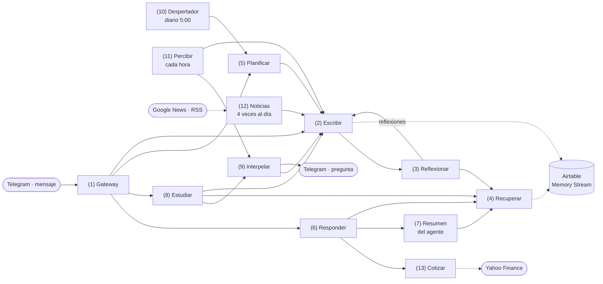

# Human_proxy · Documentación técnica

Human_proxy implementa en Make.com la arquitectura de *Generative Agents: Interactive Simulacra of Human Behavior* (Park et al., 2023, [arXiv 2304.03442](https://arxiv.org/abs/2304.03442)) para agentes que conversan por Telegram. Son 13 escenarios: cinco de memoria y diálogo, la planificación y el bucle percibir-reaccionar del paper, y cinco extensiones propias para un asesor financiero que conversa con personas reales: estudio de dudas, preguntas por iniciativa propia, lectura de prensa, cotizaciones y una calculadora.

## 1. Visión general

El paper describe un agente con capacidades encadenadas sobre un único registro de memoria, el *memory stream*. Percibe y almacena cada experiencia como una observación en lenguaje natural, con su marca temporal y una puntuación de importancia. Recupera los recuerdos pertinentes combinando lo reciente, lo importante y lo relevante. Reflexiona periódicamente, sintetizando observaciones en conclusiones que vuelven al mismo registro. Y planifica su día, reaccionando a lo que percibe.

El repositorio incluye como ejemplo un agente, Borja: un asesor financiero ficticio de una firma de hedge funds del Madrid de los 90. Su personalidad está en un único sitio, su descripción, guardada en un almacén de datos. Lo propio de su oficio está en su rama de Planificar, que convierte la agenda de eventos financieros del día en su plan, en Noticias, en Cotizar y en las rutas de cartera, cotizaciones y cálculo de Responder. Para un agente de otro ámbito basta con su descripción: usa la rama genérica de Planificar, y las rutas financieras de Responder solo se activan si el mensaje habla de dinero.

| Escenario | Disparo | Función |
| --- | --- | --- |
| (1) Gateway Telegram | Mensaje en Telegram | Aplica el límite de frecuencia, pide la respuesta, la envía, la memoriza y lanza Estudiar y Planificar |
| (2) Memoria: Escribir | Webhook | Puntúa, vectoriza y guarda un recuerdo; dispara la reflexión si toca |
| (3) Memoria: Reflexionar | Webhook | Genera preguntas focales, recupera evidencias y guarda 5 reflexiones |
| (4) Memoria: Recuperar | Webhook | Devuelve los k recuerdos con mejor puntuación para una consulta |
| (5) Planificar | Webhook | Genera el plan del día: bloques de tareas para cualquier agente y, para el agente financiero, su agenda de eventos financieros |
| (6) Responder | Webhook | Construye el prompt de diálogo y genera la respuesta; registra la cartera, consulta cotizaciones y hace cálculos cuando el mensaje lo pide |
| (7) Resumen del agente | Webhook | Resume quién es el agente según su memoria, con caché de 24 h e interruptor ON/OFF |
| (8) Estudiar | Webhook | Detecta peticiones profesionales, investiga en Google y guarda conocimiento |
| (9) Interpelar | Webhook | Escribe al usuario por iniciativa propia cuando le falta un dato |
| (10) Despertador | Programado, diario a las 5:00 | Lanza la planificación aunque nadie escriba |
| (11) Percibir y reaccionar | Programado, cada hora de 9:00 a 23:00 en laborables | Estudia el punto del plan que tocaba, calcula su implicación para cada usuario y pregunta si falta un dato |
| (12) Noticias | Programado, laborables a las 8:00, 12:00, 16:00 y 20:00 | Lee titulares de prensa económica y guarda los que afectan a la cartera de cada usuario, con su implicación |
| (13) Cotizar | Webhook | Devuelve precio, cierre anterior, moneda y hora de hasta 5 valores o índices |

Los modelos son Gemini 3.8 Flash para todo el razonamiento en lenguaje natural y Gemini Embedding 2, con 768 dimensiones, para los vectores. Las cuentas no las hace el modelo: las ejecuta el módulo Make Code en JavaScript. La memoria vive en Airtable, la cartera y las cachés en almacenes de datos de Make, y las cotizaciones salen de Yahoo Finance.

## 2. Arquitectura

Cada escenario es una función: un webhook de entrada, un cuerpo JSON con sus parámetros y una respuesta JSON, o un «Accepted» inmediato si trabaja en segundo plano. Solo el Gateway recibe de Telegram. Solo Escribir crea recuerdos y solo Recuperar hace la búsqueda puntuada; los demás hacen operaciones simples en la tabla, como contar mensajes, leer el historial o leer el plan vigente.

Un mensaje recorre el sistema así:

1. El Gateway lee el perfil del agente, comprueba el límite de frecuencia y llama a Responder.
2. Responder pide el resumen del agente, lee lo que sabe del interlocutor, busca el bloque del plan vigente, recupera los recuerdos relevantes y el historial y lee la cartera del usuario. Si el mensaje comunica posiciones, las registra; si pregunta por precios, llama a Cotizar y valora la cartera; si pide una cuenta, la calcula. Con todo ello genera la respuesta.
3. El Gateway la envía a Telegram y guarda el mensaje y la respuesta como dos observaciones.
4. El Gateway pasa el mensaje a Estudiar en segundo plano y, si el agente aún no tiene plan para hoy, llama a Planificar.
5. Cada escritura suma la importancia de las observaciones aún no reflejadas y, por encima de 150, lanza Reflexionar.



Las flechas continuas son llamadas a webhook y las discontinuas, el acceso a la memoria o a fuentes externas. El diagrama solo muestra a Escribir y Recuperar tocando la tabla porque son los únicos que crean recuerdos y hacen la búsqueda puntuada; los demás escenarios también leen de Airtable para tareas simples, como contar mensajes o buscar el plan vigente.

Sin que nadie escriba, el Despertador planifica el día a las 5:00, Percibir revisa cada hora el plan y Noticias lee la prensa cuatro veces al día. Esta descomposición permite probar cada función sola enviando un JSON a su URL, añadir canales con un Gateway nuevo y mantener las reglas de la memoria en un único sitio.

| Escenario | Respuesta al llamante | Procesamiento |
| --- | --- | --- |
| (1) Gateway | No aplica | Secuencial, para respetar el orden de los mensajes |
| (2) Escribir | Síncrona, en cuanto el registro existe | Paralelo |
| (3) Reflexionar | 202 inmediato | Paralelo |
| (4) Recuperar | Síncrona; actualiza accesos después | Paralelo |
| (5) Planificar | «Accepted» inmediato | Secuencial, para no generar dos planes el mismo día |
| (6) Responder | Síncrona | Paralelo |
| (7) Resumen del agente | Síncrona, menos de 1 s; regenera después | Paralelo |
| (8) Estudiar | «Accepted» inmediato | Paralelo |
| (9) Interpelar | «Accepted» inmediato | Paralelo |
| (10) Despertador | No aplica | Paralelo |
| (11) Percibir y reaccionar | No aplica | Paralelo |
| (12) Noticias | No aplica | Paralelo |
| (13) Cotizar | Síncrona | Paralelo |

Make no admite el módulo de respuesta de webhook en un escenario secuencial y, además, desactiva un escenario secuencial en cuanto una ejecución falla. Por eso Planificar no devuelve nada y los escenarios que no deben pararse llevan un manejador de error Ignore en sus módulos externos (tabla de ajustes y sección 20).

### Ajustes de cada escenario

| Escenario | Programación | Procesamiento | Manejador Ignore |
| --- | --- | --- | --- |
| (1) Gateway | Inmediata, al llegar un mensaje | Secuencial | En los 11 módulos externos |
| (2) Escribir | Inmediata | Paralelo | No |
| (3) Reflexionar | Inmediata | Paralelo | No |
| (4) Recuperar | Inmediata | Paralelo | No |
| (5) Planificar | Inmediata | Secuencial | En sus módulos externos |
| (6) Responder | Inmediata | Paralelo | En los 8 módulos de las rutas de cartera, cotizaciones y cálculo |
| (7) Resumen del agente | Inmediata | Paralelo | No |
| (8) Estudiar | Inmediata | Paralelo | En los 5 módulos externos |
| (9) Interpelar | Inmediata | Paralelo | En los 5 módulos externos |
| (10) Despertador | Diaria, 5:00 (Europe/Madrid) | Paralelo | En la llamada a Planificar |
| (11) Percibir y reaccionar | Laborables, a cada hora en punto de 9:00 a 23:00 (Europe/Madrid) | Paralelo | En los 8 módulos externos |
| (12) Noticias | Laborables a las 8:00, 12:00, 16:00 y 20:00 (Europe/Madrid) | Paralelo | En los 6 módulos externos |
| (13) Cotizar | Inmediata | Paralelo | En la consulta a Yahoo Finance |

Todos usan el máximo de 3 errores seguidos de Make antes de desactivarse y confirman cada operación al terminarla (auto-commit).

Cada escenario lleva notas de Make en sus webhooks y en cada llamada a webhook, con el origen y el destino:

| Webhook de destino | Lo llaman (escenario y módulo) |
| --- | --- |
| (2) Escribir | Gateway 4 y 5, Reflexionar 11, Planificar 13 y 106, Estudiar 6, Interpelar 6, Percibir 10, Noticias 11 |
| (3) Reflexionar | Escribir 8 |
| (4) Recuperar | Reflexionar 16, Responder 2 y 10, Resumen 10, 12 y 14, Estudiar 4 |
| (5) Planificar | Gateway 13, Despertador 2 |
| (6) Responder | Gateway 2 |
| (7) Resumen del agente | Responder 9 |
| (8) Estudiar | Gateway 15 |
| (9) Interpelar | Estudiar 7, Percibir 11 |
| (13) Cotizar | Responder 23 |

## 3. Modelo de datos

### La tabla Memory Stream

Toda la memoria vive en una sola tabla de Airtable, igual que en el paper, donde observaciones, reflexiones y planes son objetos del mismo registro y se recuperan con el mismo mecanismo. Cada fila es un recuerdo y el campo Tipo distingue su naturaleza.

| Campo | Tipo Airtable | Quién lo escribe | Significado |
| --- | --- | --- | --- |
| Memoria | Texto largo (campo primario) | Escribir | Descripción en lenguaje natural del recuerdo |
| Tipo | Selección única: observacion, reflexion, plan, conocimiento | Escribir | Naturaleza del recuerdo |
| Agente | Texto de una línea | Escribir | Agente propietario del recuerdo |
| Chat_ID | Texto de una línea | Escribir | Chat de Telegram; segmenta la memoria por conversación. Los planes usan `GLOBAL` |
| Autor | Selección única: usuario, agente, sistema | Escribir | Quién originó el contenido |
| Importancia | Número | Escribir | Intensidad emocional de 1 a 10 asignada por el LLM |
| Creado | Fecha de creación (automático) | Airtable | Marca temporal de creación |
| Ultimo_acceso | Fecha con hora | Escribir y Recuperar | Última vez que el recuerdo se creó o se recuperó; base de la recencia |
| Embedding | Texto largo | Escribir | Vector de 768 dimensiones serializado como `[n1, n2, …]` |
| Evidencias | Vínculo a registros de la misma tabla | Reflexionar | Recuerdos que justifican una reflexión |
| Citada_por | Vínculo recíproco de Evidencias | Airtable | Reflexiones que citan este recuerdo |
| Reflejada | Casilla | Reflexionar | La observación ya se ha contado para una reflexión |
| Plan_ubicacion | Texto de una línea | Planificar | Lugar del bloque de plan; en el agente financiero, ámbito del evento |
| Plan_inicio | Fecha con hora | Planificar | Inicio del bloque |
| Plan_duracion_min | Número | Planificar | Duración en minutos |

Tres decisiones conviene tenerlas presentes. El paper guarda para cada objeto la descripción, la marca de creación y la de último acceso; aquí son Memoria, Creado y Ultimo_acceso, y el resto son añadidos para operar con varios agentes y conversaciones. El embedding se guarda como texto porque Airtable no tiene un tipo vectorial; ocupa unos 8–10 KB por fila y es la razón de que la recuperación tenga un techo de 300 registros. Evidencias es un vínculo real entre filas, así que el árbol de reflexiones del paper se puede navegar desde Airtable siguiendo Citada_por.

Reflejada no está en el paper. Allí la reflexión se dispara cuando «la suma de importancia de los eventos más recientes» supera un umbral; sin un estado explícito, cada observación nueva volvería a sumar las anteriores y el umbral se superaría en todos los mensajes a partir del primero que lo cruza. Reflejada funciona como un contador que se pone a cero.

Escribir crea los registros con la conversión de tipos de Airtable (typecast) activada, para que acepte valores nuevos en Tipo e intente convertir a número una importancia que llegue como texto.

Algunos textos siguen una convención porque otros escenarios buscan por ellos. Las observaciones que nacen de Interpelar empiezan por «{agente} le planteó una duda a». Los planes de la rama genérica empiezan por «Plan de {agente} para el» y los del agente financiero por «Evento financiero del». Las lecturas de prensa de Noticias empiezan por «{agente} leyó en prensa».

Todos los escenarios que buscan el plan lo hacen por el tipo `plan`, sea cual sea la rama que lo generó. Versiones anteriores guardaban la agenda financiera con un tipo propio, `evento`; esos registros siguen en la tabla como recuerdos, pero ningún escenario los busca ya.

### Almacenes de datos de Make

| Almacén | Clave | Contenido |
| --- | --- | --- |
| Caché (campos agente, chat_id, resumen, actualizado) | `perfil\|<agente>` | Descripción del personaje, en el campo resumen, con chat_id `GLOBAL` |
| | `<agente>\|<chat_id>` | Resumen del agente en ese chat (escenario 7) |
| | `rel\|<agente>\|<chat_id>` | Lo que el agente sabe de su interlocutor (escenario 6) |
| Cartera (campos agente, chat_id, cartera, posiciones, actualizado) | `<agente>\|<chat_id>` | En `cartera`, un resumen en texto de las posiciones, los intereses y el horizonte del usuario; en `posiciones`, la lista estructurada en JSON. La escribe Responder y la leen Responder, Percibir y Noticias |

El perfil es la única fuente de la personalidad. Lo leen el Gateway, el Despertador y Percibir, y el Gateway lo pasa a Responder, Estudiar y Planificar. El límite de longitud de las respuestas no está en el perfil, porque solo aplica a Telegram: el Gateway añade «Limita la respuesta a una o dos frases, sin pasar de 20 palabras» únicamente en la llamada a Responder.

El campo `posiciones` es un texto con una lista JSON, un objeto por valor:

```json
[{"simbolo": "ITX.MC", "nombre": "Inditex", "cantidad": 50, "precio_medio": 45, "moneda": "EUR"}]
```

El símbolo es el de Yahoo Finance, para que la calculadora pueda cruzarlo con las cotizaciones. Una cantidad o un precio medio de 0 significan que el usuario no los dio.

El módulo Data store · Get a record exige `returnWrapped: false` en el blueprint aunque la interfaz no lo muestre; sin él falla con `BundleValidationError`.

## 4. (1) Gateway Telegram

El Gateway es el único escenario que conoce Telegram; los demás son funciones independientes del canal. Responde primero y memoriza después, para que el usuario reciba la respuesta cuanto antes y para que el mensaje actual no compita consigo mismo en la recuperación.

| # | Módulo | Qué hace |
| --- | --- | --- |
| 1 | Telegram Bot · Watch Updates | Recibe los mensajes del bot |
| filtro | Mensaje de texto (no comandos) | Solo pasa si `message.text` existe y no empieza por «/» |
| 6 | Airtable · Search records | Mensajes del usuario en este chat en los últimos 10 minutos, hasta 10 |
| 7 | Tools · Numeric aggregator | Los cuenta con `if(6.id; 1; 0)`, para que una búsqueda vacía cuente 0 |
| 8 | Router | Ruta 1 si hay menos de 10 mensajes; ruta 2 si hay 10 o más |
| R2 · 10 | Telegram Bot · Send a Text Message | Responde «Descansamos un poco. Inténtalo en un par de minutos» y no sigue |
| R1 · 960 | Data store · Get a record | Lee `perfil\|<agente>` |
| R1 · 2 | HTTP · POST a Responder | agente, `modo` (ON/OFF del resumen), chat_id, mensaje, usuario y descripción |
| R1 · 957 | Slack · Create a message | Registro opcional de cada intercambio en un canal |
| R1 · 3 | Telegram Bot · Send a Text Message | Envía la respuesta al chat |
| R1 · 4 | HTTP · POST a Escribir | Guarda «{nombre} le dijo a {agente}: «{mensaje}»», autor usuario |
| R1 · 5 | HTTP · POST a Escribir | Guarda «{agente} le respondió a {nombre}: «{respuesta}»», autor agente |
| R1 · 15 | HTTP · POST a Estudiar | Pasa el mensaje para que decida si investigar; no espera |
| R1 · 11 | Airtable · Search records | ¿Tiene el agente algún plan con fecha de hoy (Europe/Madrid)? |
| R1 · 12 | Tools · Numeric aggregator | Cuenta los planes de hoy |
| R1 · 13 | HTTP · POST a Planificar | Solo si no hay plan de hoy; no espera |

Todos los módulos que pueden fallar llevan un manejador Ignore: si uno falla, esa ejecución termina y el Gateway sigue activo para el siguiente mensaje. Sin ellos, Make desactivaría el escenario al primer error porque es secuencial.

El límite de frecuencia protege el consumo frente a ráfagas. Cuenta solo los mensajes del usuario ya guardados; como el mensaje en curso se guarda después de responder, no se cuenta a sí mismo. La condición de fecha, `IS_AFTER({Creado}, DATEADD(NOW(), -10, 'minutes'))`, compara instantes absolutos y no depende de la zona horaria.

La búsqueda de Airtable en Make devuelve un paquete vacío (`__IMTLENGTH__` = 0) cuando no encuentra nada. Por eso los contadores suman `if(id; 1; 0)` en lugar de 1.

Las observaciones se redactan en tercera persona y con el nombre del interlocutor porque el paper guarda las percepciones como frases narrativas («Isabella Rodriguez is setting out the pastries»). Así el texto que luego lee el LLM es autoexplicativo.

El procesamiento secuencial hace que tres mensajes seguidos se ejecuten uno detrás de otro. Sin él, el segundo podría recuperar memoria antes de que se guardara el primero. El coste es la latencia: cada mensaje espera al anterior, unos 10–20 segundos.

Todos los textos que entran en un cuerpo JSON pasan por `escapeJSON()`, para que unas comillas o un salto de línea no rompan la llamada. Telegram solo admite un webhook por bot: si el bot ya lo usaba otro escenario, este deja de recibir al crear el del Gateway.

Para tener varios agentes basta con duplicar el Gateway y cambiar el nombre del agente, la clave del perfil y la conexión de Telegram: la memoria ya está separada por el campo Agente.

## 5. (2) Memoria: Escribir

Escribir es la única puerta de entrada a la memoria: toda observación, reflexión, plan o pieza de conocimiento pasa por aquí, así que todos quedan puntuados y vectorizados con el mismo criterio. Responde en cuanto el registro existe y después comprueba si hay que reflexionar.

| # | Módulo | Qué hace |
| --- | --- | --- |
| 1 | Webhooks · Custom webhook | Entrada |
| 2 | Gemini · Generate a response | Puntúa la importancia del recuerdo de 1 a 10 |
| 3 | Gemini · Generate embeddings | Vector de la memoria, 768 dimensiones |
| 4 | Airtable · Create a record | Crea la fila con typecast, Importancia, Ultimo_acceso = ahora y Embedding |
| 5 | Webhooks · Webhook response | 200 con `{"id", "importancia", "tipo"}` |
| 6 | Airtable · Search records | Observaciones del mismo agente y chat sin reflejar (hasta 500) |
| 7 | Tools · Numeric aggregator | Suma su importancia |
| 8 | HTTP · POST a Reflexionar | Solo si la suma supera 150 y el recuerdo nuevo es una observación |

### Importancia

El paper pide al LLM que puntúe la intensidad del recuerdo con una escala anclada en dos ejemplos extremos. El prompt es su traducción, con la instrucción añadida de devolver solo el número:

```text
En una escala del 1 al 10, donde 1 es puramente mundano (p. ej., cepillarse los dientes, hacer la cama) y 10 es extremadamente conmovedor (p. ej., una ruptura, ser admitido en la universidad), puntúa la probable intensidad emocional del siguiente recuerdo de {{1.agente}}.
Responde únicamente con un número entero del 1 al 10.
Recuerdo: {{1.memoria}}
Puntuación:
```

La importancia se calcula una vez y no cambia. Es lo que permite que un acontecimiento importante siga apareciendo semanas después aunque su recencia haya caído.

### Embedding

El vector se guarda como texto entre corchetes. Su dimensión debe coincidir con la de la consulta en Recuperar (768 en ambos). Si se cambia el modelo o la dimensión en uno de los dos, hay que cambiarla en el otro y recalcular los embeddings existentes: la similitud entre vectores de distinta longitud se trata como 0.

### Disparo de la reflexión

El filtro del módulo 8 exige dos condiciones: suma mayor que 150 y tipo observacion. La segunda evita un bucle, porque las reflexiones también se guardan llamando a Escribir. Con mensajes de chat corrientes, que el modelo suele puntuar entre 2 y 4, el umbral se alcanza tras unas 40–60 observaciones, es decir, 20–30 intercambios.

### Entrada y salida

Entrada: `memoria` (obligatorio), `tipo`, `agente`, `chat_id`, `autor` y, opcionales, `evidencias` (IDs de registro), `plan_ubicacion`, `plan_inicio` y `plan_duracion_min`. Salida: `{"id": "rec…", "importancia": "4", "tipo": "observacion"}`.

## 6. (3) Memoria: Reflexionar

Reflexionar convierte una acumulación de observaciones en cinco conclusiones de nivel superior, cada una vinculada a los recuerdos que la justifican, con los tres pasos del paper: preguntas focales, recuperación de evidencias e inferencia de insights. Lo llama Escribir al cruzar el umbral; también se puede llamar a mano con `{"agente", "chat_id"}`.

### Respuesta inmediata y router

El módulo 2 responde 202 nada más recibir la llamada, porque la reflexión tarda alrededor de un minuto y Escribir no debe esperarla. Un router reparte después la ejecución en dos rutas que Make recorre en orden.

La ruta 1 (módulos 12 y 13) marca como reflejadas las observaciones pendientes. Va primero a propósito: si durante la reflexión entran mensajes nuevos, Escribir no volverá a encontrar las mismas observaciones por encima de 150 y no lanzará una reflexión duplicada.

### Ruta 2: la reflexión

| # | Módulo | Qué hace |
| --- | --- | --- |
| 4 | Airtable · Search records | Los 100 registros más recientes del agente y chat, de todos los tipos |
| 6 | Tools · Text aggregator | Una línea por registro: `n. (recID) texto` |
| 7 | Gemini | Genera las 3 preguntas de alto nivel, una por línea |
| 15 | Iterator | Recorre las preguntas |
| 16 | HTTP · POST a Recuperar | Cada pregunta como consulta, k = 10 |
| 17 | Tools · Text aggregator | Reúne por pregunta las memorias recuperadas con sus IDs |
| 8 | Gemini (salida JSON con esquema) | Infiere 5 insights, cada uno con su lista de evidencias |
| 9 | JSON · Parse JSON | Convierte la respuesta |
| 10 | Iterator | Recorre los insights |
| 11 | HTTP · POST a Escribir | Guarda el insight como reflexion, autor sistema |
| 14 | Airtable · Update a record | Rellena Evidencias con los IDs citados |

El prompt de preguntas focales traduce el del paper:

```text
Recuerdos recientes de {{1.agente}}:
{{6.text}}

Basándote únicamente en la información anterior, ¿cuáles son las 3 preguntas de alto nivel más relevantes que podemos responder sobre los sujetos de estas afirmaciones?
Responde solo con las 3 preguntas, una por línea, sin numeración.
```

Y el de insights, ampliado para obtener las evidencias en un formato que Make pueda procesar:

```text
Para cada pregunta de alto nivel, estas son las afirmaciones relevantes que recuerda {{1.agente}} (cada una con su identificador entre paréntesis):
{{17.text}}

¿Qué 5 conclusiones de alto nivel puedes inferir de las afirmaciones anteriores? (formato de ejemplo: conclusión (por 1, 5, 3))
Devuelve exclusivamente un JSON con esta forma: {"insights": [{"insight": "texto de la conclusión", "evidencias": ["recXXXXXXXXXXXXXX"]}]}. En "evidencias" pon los identificadores (los que van entre paréntesis, empiezan por rec) de las afirmaciones que justifican cada conclusión, copiados literalmente.
```

El módulo 8 fija `responseMimeType: application/json` y un `responseSchema`, de modo que Gemini no puede devolver prosa alrededor del JSON.

La recuperación de evidencias reutiliza Recuperar para usar exactamente el mismo mecanismo que en la conversación, como hace el paper. De paso, los recuerdos usados como evidencia actualizan su último acceso. Como la búsqueda incluye reflexiones anteriores, una reflexión nueva puede citar a otra antigua: es el árbol de reflexiones del paper.

El insight se guarda primero llamando a Escribir, para que tenga importancia y embedding como cualquier recuerdo, y después el módulo 14 añade los vínculos. Así se evita reserializar el array de evidencias dentro de otro cuerpo JSON.

## 7. (4) Memoria: Recuperar

Recuperar recibe una consulta en lenguaje natural y devuelve los k recuerdos del agente y chat con mayor puntuación combinada de recencia, importancia y relevancia: la función de recuperación del paper con todos los pesos a 1. El cálculo se hace en un módulo de código porque Make no tiene un operador de similitud vectorial.

| # | Módulo | Qué hace |
| --- | --- | --- |
| 1 | Webhooks · Custom webhook | Entrada |
| 2 | Gemini · Generate embeddings | Vector de la consulta, mismo modelo y dimensión que Escribir |
| 3 | Airtable · Search records | Hasta 300 registros del agente y chat, los más recientes primero |
| 4 | Tools · Text aggregator | Serializa cada registro como una línea JSON |
| 5 | Make Code · Execute code | Calcula las puntuaciones y elige el top-k |
| 6 | Webhooks · Webhook response | Devuelve el resultado |
| 7 | Iterator | Recorre los IDs elegidos |
| 8 | Airtable · Update a record | Pone Ultimo_acceso = ahora en cada recuerdo recuperado |

### La fórmula

```latex
\text{score}(m) = \alpha_{rec}\,\widehat{\text{rec}}(m) + \alpha_{imp}\,\widehat{\text{imp}}(m) + \alpha_{rel}\,\widehat{\text{rel}}(m), \qquad \alpha_{rec} = \alpha_{imp} = \alpha_{rel} = 1
```

```latex
\text{rec}(m) = 0.995^{\,h(m)}, \qquad \text{rel}(m) = \frac{q \cdot e_m}{\lVert q \rVert\,\lVert e_m \rVert}, \qquad \widehat{x} = \frac{x - \min x}{\max x - \min x}
```

h(m) son las horas desde el último acceso al recuerdo (o desde su creación si no tiene acceso), imp(m) es su importancia, q el embedding de la consulta y e_m el del recuerdo. Cada componente se normaliza min-max sobre el conjunto evaluado, para que los tres pesen igual aunque sus escalas sean distintas; si todos los valores de un componente coinciden, ese componente vale 0 y no influye.

Con un decaimiento de 0,995 por hora, un recuerdo conserva el 89 % de su recencia a las 24 horas, el 43 % a la semana y el 3 % al mes. Como se mide desde el último acceso, un recuerdo antiguo que se recupera a menudo se mantiene fresco, como en el paper. Allí las horas eran del mundo simulado; aquí son reales.

### Por qué los datos viajan como texto

El módulo 4 construye una línea JSON por registro con `escapeJSON()`. El código extrae los números de los vectores con una expresión regular en lugar de `JSON.parse`, porque Make no siempre serializa los arrays como JSON válido.

### El código del módulo 5

Entradas: `consulta_emb` = `[2.embedding.values]`, `registros` = `4.text`, `k` = `ifempty(1.k; 10)`, `ahora` = `now`.

```javascript
// [Human_proxy] Recuperación de memorias (Park et al., 2023, §4.1)
// score = recencia + importancia + relevancia (alfa = 1), cada componente normalizado min-max a [0,1]
const { consulta_emb, registros, k, ahora } = input;

// Los vectores llegan como texto; se extraen los números con regex
const vec = t => (String(t || '').match(/-?\d+(?:\.\d+)?(?:e[-+]?\d+)?/gi) || []).map(Number);
const q = vec(consulta_emb);
const lineas = String(registros || '').split('\n').map(l => l.trim()).filter(Boolean);
const recs = [];
for (const l of lineas) { try { recs.push(JSON.parse(l)); } catch (e) { /* línea corrupta: se ignora */ } }
const K = parseInt(k, 10) > 0 ? parseInt(k, 10) : 10;
const now = ahora ? new Date(ahora) : new Date();

const coseno = (a, b) => {
  if (!a.length || a.length !== b.length) return 0;
  let p = 0, na = 0, nb = 0;
  for (let i = 0; i < a.length; i++) { p += a[i] * b[i]; na += a[i] * a[i]; nb += b[i] * b[i]; }
  return na && nb ? p / (Math.sqrt(na) * Math.sqrt(nb)) : 0;
};

const filas = recs.map(r => {
  const horas = Math.max(0, (now - new Date(r.acc)) / 3.6e6);
  return {
    id: r.id, memoria: r.txt, tipo: r.tipo, creado: r.creado,
    importancia: Number(r.imp) || 0,
    recencia: isFinite(horas) ? Math.pow(0.995, horas) : 0,
    relevancia: coseno(q, vec(r.emb)),
  };
});

const norm = campo => {
  const v = filas.map(f => f[campo]);
  const min = Math.min(...v), max = Math.max(...v);
  filas.forEach(f => { f[campo + '_n'] = max > min ? (f[campo] - min) / (max - min) : 0; });
};
['recencia', 'importancia', 'relevancia'].forEach(norm);
filas.forEach(f => { f.score = f.recencia_n + f.importancia_n + f.relevancia_n; });
filas.sort((a, b) => b.score - a.score);

const top = filas.slice(0, K).map(f => ({
  id: f.id, memoria: f.memoria, tipo: f.tipo, creado: f.creado,
  score: +f.score.toFixed(4), recencia: +f.recencia_n.toFixed(4),
  importancia: +f.importancia_n.toFixed(4), relevancia: +f.relevancia_n.toFixed(4),
}));
const texto = top.map((m, i) => `${i + 1}. ${m.memoria}`).join('\n');
const texto_ids = top.map(m => `(${m.id}) ${m.memoria}`).join('\n');

return {
  ids: top.map(m => m.id), texto, texto_ids, total_evaluadas: filas.length,
  respuesta: JSON.stringify({ memorias: top, texto, texto_ids, total_evaluadas: filas.length }),
};
```

La salida trae el mismo resultado en tres formas: `memorias`, con las puntuaciones desglosadas, para depurar; `texto`, una lista numerada lista para un prompt (la usa Responder); y `texto_ids`, la misma lista con el ID de cada recuerdo (la usa Reflexionar para citar evidencias). Los módulos 7 y 8 se ejecutan después de responder, así que actualizar los accesos no añade latencia.

## 8. (5) Planificar

Planificar genera una vez al día el plan del agente y lo guarda como recuerdos de tipo `plan` con Chat_ID `GLOBAL`, porque el agente tiene un único día para todos sus interlocutores. Lo llaman el Despertador a las 5:00 y el Gateway si al llegar un mensaje todavía no hay plan de hoy.

Tras el webhook, un router reparte en dos rutas excluyentes:

| Ruta | Para quién | Qué genera |
| --- | --- | --- |
| Es cualquier otro | Cualquier agente salvo el financiero | Un plan de 5 a 8 puntos coherente con su personaje, su ciudad, su época y el día de la semana, descompuesto en bloques de una hora como máximo |
| Es Borja · plan de eventos financieros | El agente financiero | Su plan del día es la agenda de eventos financieros: cada evento con hora confirmada es un bloque de 30 minutos |

La ruta genérica:

| # | Módulo | Qué hace |
| --- | --- | --- |
| 3 | Tools · Set variables | Fecha de hoy (o la recibida en `fecha`), ayer, día de la semana en español y fecha larga |
| 4 | Airtable · Search records | ¿Hay ya algún plan del agente con fecha de hoy? |
| 5 | Tools · Numeric aggregator | Los cuenta con `if(id; 1; 0)` |
| 6 | Airtable · Search records | Los planes de ayer, hasta 50, para dar continuidad |
| 7 | Tools · Text aggregator | Su texto |
| 8 | Gemini | Plan del día en trazos gruesos; solo si no hay plan de hoy |
| 9 | Gemini (salida JSON con esquema) | Bloques con inicio, duración en minutos, actividad y lugar |
| 10 | JSON · Parse JSON | Convierte la respuesta |
| 11 | Iterator | Recorre los bloques |
| 12 | Tools · Set variables | Une fecha y hora de inicio en la hora local |
| 13 | HTTP · POST a Escribir | Guarda el bloque como `plan` con Chat_ID `GLOBAL`, Plan_inicio, Plan_duracion_min y Plan_ubicacion |

El plan en trazos gruesos:

```text
Esto es lo que tenía planificado {{1.agente}} para ayer:
{{ifempty(7.text; "(no hay registro del día anterior)")}}

Hoy es {{3.dia_semana}}, {{3.fecha_larga}}. Este es el plan de {{1.agente}} para hoy, a grandes rasgos, en 5 a 8 puntos con su hora aproximada, coherente con su personaje, su ciudad, su época y el día de la semana.
Responde solo con la lista numerada, un punto por línea.
```

Su descomposición en bloques:

```text
Plan de {{1.agente}} para hoy ({{3.dia_semana}}, {{3.fecha_larga}}), a grandes rasgos:
{{8.result}}

Descompón este plan en bloques consecutivos de una hora como máximo, desde que {{1.agente}} se levanta hasta que se acuesta. Para cada bloque indica la hora de inicio (HH:mm, formato 24 h), la duración en minutos, la actividad concreta en una frase en tercera persona y el lugar donde ocurre.
Devuelve exclusivamente un JSON con esta forma: {"bloques": [{"inicio": "07:00", "duracion_min": 60, "actividad": "...", "ubicacion": "..."}]}
```

Con este esquema de salida:

```json
{"type": "object", "properties": {"bloques": {"type": "array", "items": {"type": "object", "properties": {"inicio": {"type": "string"}, "duracion_min": {"type": "integer"}, "actividad": {"type": "string"}, "ubicacion": {"type": "string"}}, "required": ["inicio", "duracion_min", "actividad", "ubicacion"]}}}, "required": ["bloques"]}
```

Un bloque queda guardado como «Plan de Ana para el viernes 23/10/2026, de 14:30 a 15:30: …».

La ruta del agente financiero (módulos 100 a 109):

| # | Módulo | Qué hace |
| --- | --- | --- |
| 100 | Tools · Set variables | Fecha de hoy, fecha larga y día de la semana |
| 101 | Airtable · Search records | ¿Hay ya algún plan del agente con fecha de hoy? |
| 102 | Tools · Numeric aggregator | Los cuenta |
| 103 | Gemini con búsqueda de Google | La agenda financiera del día, una línea por evento; solo si no hay plan de hoy |
| 104 | Iterator | Recorre las líneas |
| 105 | Tools · Set variables | Descarta las líneas que no empiezan por `HH:mm\|` y separa hora, evento, ámbito y fuente |
| 106 | HTTP · POST a Escribir | Guarda el evento como `plan`, con la hora en Plan_inicio, 30 minutos de duración y el ámbito en Plan_ubicacion |

```text
Hoy es {{100.ev_dia}}, {{100.ev_fecha_larga}}. Busca la agenda de eventos financieros de hoy que seguiría un asesor financiero en Madrid: datos macroeconómicos de España, la zona euro y Estados Unidos, decisiones o comparecencias de bancos centrales, subastas de deuda relevantes y resultados empresariales del Ibex 35 y de las grandes cotizadas de Estados Unidos.
Incluye solo eventos de hoy con hora confirmada por una fuente, con la hora convertida a la de Madrid. Entre 3 y 8 eventos, los de mayor impacto.
Responde únicamente con una línea por evento, ordenadas por hora, con este formato exacto y sin nada más:
HH:mm|evento en una frase|ámbito (España, Zona euro, EE. UU. o empresa)|fuente
Si hoy no hay eventos relevantes, responde únicamente: NINGUNO
```

Un evento queda guardado como «Evento financiero del martes 27/10/2026 a las 09:00: Publicación de la tasa de desempleo y la Encuesta de Población Activa del tercer trimestre (España; fuente: Instituto Nacional de Estadística)».

El plan del agente financiero tiene huecos: entre un evento y el siguiente, Responder le dice que no tiene nada concreto planificado. Es deliberado, porque su trabajo del día gira en torno a esos momentos; si se quisiera que estuviera siempre ocupado, bastaría con alargar cada bloque hasta el evento siguiente.

Plan_inicio se escribe en ISO con el desfase de Madrid, así que Airtable guarda el instante correcto. La instrucción de sistema de Gemini es la descripción del personaje, o su nombre si no llega descripción. El escenario es secuencial: si dos llamadas piden plan a la vez, la segunda espera y, al llegar su turno, encuentra el plan escrito y no hace nada.

## 9. (6) Responder

Responder genera lo que dice el agente con el prompt de diálogo del paper: quién es, qué hora es, qué está haciendo, qué sabe de su interlocutor, qué recuerda y qué se ha dicho. A eso suma tres capacidades de su oficio, cada una en una ruta que solo se activa cuando el mensaje la necesita: registrar la cartera, consultar cotizaciones con la valoración de la cartera, y hacer cuentas. No escribe en la memoria de la conversación; eso lo hace el Gateway después de enviar la respuesta, para que Responder pueda usarse desde otros canales o en pruebas.

| # | Módulo | Qué hace |
| --- | --- | --- |
| 1 | Webhooks · Custom webhook | Entrada |
| 9 | HTTP · POST a Resumen del agente | Resumen del agente; vacío si el modo no es ON |
| 2 | HTTP · POST a Recuperar | El mensaje como consulta, k = 10 |
| 12 | Data store · Get a record | Lo que el agente sabe del interlocutor (`rel\|agente\|chat_id`) |
| 3 | Airtable · Search records | Las 12 observaciones más recientes del chat |
| 4 | Tools · Text aggregator | Una línea por observación: `- [autor] texto` |
| 7 | Airtable · Search records | El bloque del plan que abarca este momento |
| 8 | Tools · Text aggregator | Su texto, o vacío |
| 21 | Data store · Get a record | La cartera del usuario (`agente\|chat_id` en Cartera) |
| 20 | Router | Cuatro rutas, que Make ejecuta en este orden |
| R1 · 30 | Gemini (salida JSON con esquema) | Solo si el mensaje habla de posiciones propias: decide si las comunica y devuelve la cartera completa resultante |
| R1 · 31 | Data store · Add a record | Si hay cambio, guarda resumen y posiciones en Cartera |
| R1 · 32 y 33 | Tools · Set variable | `cartera_nueva` y `posiciones_nuevas`, para que las rutas siguientes usen la cartera ya actualizada |
| R2 · 22 | Gemini (salida JSON con esquema) | Solo si el mensaje pregunta por precios o mercado: los símbolos de Yahoo Finance que hacen falta, hasta 5 |
| R2 · 23 | HTTP · POST a Cotizar | Si hay símbolos; la respuesta llega sin interpretar, como texto |
| R2 · 28 | Tools · Get variable | `posiciones_nuevas` |
| R2 · 27 | Make Code (JavaScript) | Formatea las cotizaciones y valora la cartera |
| R2 · 24 | Tools · Set variable | `cotizaciones` |
| R3 · 40 | Gemini (salida JSON con esquema) | Solo si el mensaje pide o implica una cuenta: plantea la cuenta y escribe el código que la resuelve |
| R3 · 41 | Make Code (JavaScript) | Ejecuta ese código si pasa el filtro de seguridad |
| R3 · 42 | Tools · Set variable | `calculo`: planteamiento y resultado |
| R4 · 25, 26 y 29 | Tools · Get variable | `cotizaciones`, `cartera_nueva` y `calculo` |
| R4 · 5 | Gemini · Generate a response | Genera la respuesta |
| R4 · 6 | Webhooks · Webhook response | `{"respuesta": "…"}` |
| R4 · 10 | HTTP · POST a Recuperar | Solo si la relación no existe o tiene más de 24 h: qué sabe el agente de esa persona, k = 10 |
| R4 · 11 | Gemini | La resume en una o dos frases |
| R4 · 13 | Data store · Add a record | La guarda, salvo que diga que aún no sabe nada concreto |

Las rutas 1 a 3 empiezan con un filtro por expresión regular sobre el mensaje, sin distinguir mayúsculas, para no gastar una llamada a Gemini en cada mensaje. Si el filtro no pasa, la ruta no hace nada y su variable queda vacía. La ruta 4 no tiene filtro y siempre responde.

| Ruta | Expresión que la activa |
| --- | --- |
| R1 · cartera | `compr[eéoaá]\|vend[iíoaá]\|tengo .*(acci\|particip\|t[ií]tulo\|fondo\|etf\|bono\|letra\|euros en\|d[oó]lares en)\|mi cartera\|invierto\|he invertido\|he metido\|he puesto\|liquid\|deshec\|ampli[eéoa]\|reduj\|reduzc\|deshacerme\|me he salido\|he salido de` |
| R2 · cotizaciones | `cotiz\|precio\|cu[aá]nto (vale\|est[aá]\|cotiza)\|c[oó]mo (va\|est[aá]\|ha cerrado\|ha abierto\|cerr[oó]\|abri[oó])\|bolsa\|ibex\|acci[oó]n\|acciones\|cartera\|mercado\|sub(e\|en\|i[oó]\|ido)\|baj(a\|an\|[oó]\|ado)\|ca(e\|en\|[ií]do\|y[oó])\|nasdaq\|s&p\|dow jones\|[íi]ndice\|euro stoxx\|etf` |
| R3 · cálculo | `calcul\|cu[aá]nto (ser[ií]a\|tendr[ií]a\|ganar[ií]a\|ganar[eé]\|pagar[ií]a\|pagar[eé]\|me queda\|me quedar[ií]a\|me costar[ií]a\|necesito\|hace falta\|rinde\|renta)\|inter[eé]s\|hipoteca\|cuota\|rentabilidad\|anualizad\|compuest\|amortiz\|\btae\b\|\btin\b\|plazo fijo\|jubila\|inflaci[oó]n\|[0-9] ?%\|[0-9] ?a[nñ]os` |

Las expresiones son deliberadamente amplias: un falso positivo cuesta una llamada a Gemini que devuelve «no hace falta», mientras que un falso negativo deja al agente sin el dato.

### Ruta 1: registrar la cartera

El módulo 30 recibe las posiciones registradas, el resumen y el mensaje:

```text
Posiciones registradas de {{ifempty(1.usuario; "esta persona")}} (JSON; vacío si no hay ninguna): {{ifempty(21.posiciones; "[]")}}
Resumen registrado de su cartera e intereses: {{ifempty(21.cartera; "(ninguno)")}}

Mensaje que acaba de escribir: {{1.mensaje}}

¿Comunica el mensaje, de forma explícita y en primera persona, que tiene, ha comprado, ha vendido o ha cambiado alguna posición propia? Las preguntas, las hipótesis («¿y si compro…?», «estoy pensando en…») y lo que hacen otras personas NO cuentan.
Si no la comunica, devuelve cambia=false y repite las posiciones y el resumen sin tocarlos.
Si la comunica, devuelve cambia=true y la lista COMPLETA de posiciones tras el cambio: conserva las que no menciona, suma o resta cantidades en compras y ventas parciales, elimina las vendidas por completo y recalcula el precio medio ponderado en las compras. Usa símbolos de Yahoo Finance (Bolsa de Madrid con sufijo .MC, Estados Unidos sin sufijo, ETF por su ticker de Yahoo solo si lo conoces con certeza; si no, deja el símbolo vacío). Si no da cantidad o precio, pon 0 en ese campo; no inventes cifras.
En resumen escribe en tercera persona, en una o dos frases, la cartera resultante con cantidades y precios medios, y conserva lo que el resumen anterior dijera de sus intereses, horizonte o preocupaciones.
posiciones_json debe ser exactamente la lista de posiciones como texto JSON.
```

Su esquema de salida es `{cambia, posiciones[], posiciones_json, resumen}`, con cada posición como `{simbolo, nombre, cantidad, precio_medio, moneda}`. La lista va dos veces, como objeto y como texto, porque Make guarda en el almacén el texto tal cual y no tiene una función fiable para convertir una lista en JSON.

### Ruta 2: cotizaciones y valoración

El módulo 22 elige los símbolos con el mensaje, la cartera en texto y las posiciones en JSON:

```text
Mensaje de {{ifempty(1.usuario; "su interlocutor")}} a {{1.agente}}: {{1.mensaje}}

Cartera e intereses registrados de esa persona: {{ifempty(21.cartera; "no hay cartera registrada")}}
Posiciones registradas (JSON, con su símbolo de Yahoo): {{ifempty(21.posiciones; "[]")}}

¿Necesita {{1.agente}} conocer cotizaciones actuales para responder bien a este mensaje? Si es así, devuelve como máximo 5 símbolos de Yahoo Finance de los valores o índices concretos que hacen falta: acciones de la Bolsa de Madrid con el sufijo .MC (ITX.MC, SAN.MC), acciones de Estados Unidos sin sufijo (AAPL), índices con su símbolo de Yahoo (^IBEX, ^STOXX50E, ^GSPC, ^IXIC) y ETF por su ticker de Yahoo solo si lo conoces con certeza. Si el mensaje habla de la cartera en general, usa las posiciones de la cartera registrada. Si no hacen falta cotizaciones, devuelve la lista vacía.
Devuelve exclusivamente un JSON: {"simbolos": ["..."]}
```

El módulo 27 es la calculadora de la cartera. Recibe la respuesta de Cotizar y las posiciones (las recién registradas o, si no hay, las del almacén) y devuelve un texto con una línea por cotización y, si alguna posición tiene precio, su valor, su coste y su resultado, con totales por moneda. El modelo no hace ninguna de esas cuentas: recibe las cifras hechas con la orden de usarlas tal cual.

```javascript
const { precios_json, posiciones_json } = input;
const num = (n, d) => {
  if (n === null || n === undefined || !isFinite(n)) return "s/d";
  const neg = n < 0;
  let [e, dec] = Math.abs(n).toFixed(d).split(".");
  e = e.replace(/\B(?=(\d{3})+(?!\d))/g, ".");
  return (neg ? "-" : "") + e + (d > 0 ? "," + dec : "");
};
const decs = x => Math.min(4, Math.max(2, ((String(x).split(".")[1]) || "").length));
const sig = n => (n > 0 ? "+" : "") + num(n, 2);
let precios = [];
try { precios = JSON.parse(precios_json || "{}").precios || []; } catch (e) { precios = []; }
let posiciones = [];
try { posiciones = JSON.parse(posiciones_json || "[]"); } catch (e) { posiciones = []; }
if (!Array.isArray(posiciones)) posiciones = [];

const lineas = precios.map(p => {
  if (p.precio === null || p.precio === undefined) {
    return `${p.simbolo}: sin datos${p.error ? " (" + p.error + ")" : ""}`;
  }
  const dec = decs(p.precio);
  const variacion = p.cierre_anterior ? (p.precio / p.cierre_anterior - 1) * 100 : null;
  return `${p.simbolo} (${p.nombre}): ${num(p.precio, dec)} ${p.moneda}` +
    (variacion === null ? "" : `, ${sig(variacion)} % frente al cierre anterior de ${num(p.cierre_anterior, dec)}`) +
    (p.hora ? `, dato de ${p.hora}` : "");
});

const porSimbolo = {};
for (const p of precios) {
  if (p.precio !== null && p.precio !== undefined) porSimbolo[String(p.simbolo).toUpperCase()] = p;
}
const filas = [];
const tot = {};
for (const q of posiciones) {
  const p = porSimbolo[String(q.simbolo || "").toUpperCase()];
  const cantidad = Number(q.cantidad) || 0;
  if (!p || !cantidad) continue;
  const moneda = p.moneda || q.moneda || "";
  const valor = cantidad * p.precio;
  const t = tot[moneda] || (tot[moneda] = { valor: 0, valorConCoste: 0, coste: 0 });
  t.valor += valor;
  let fila = `${q.nombre || q.simbolo}: ${num(cantidad, cantidad % 1 ? 2 : 0)} títulos a ${num(p.precio, decs(p.precio))} = ${num(valor, 2)} ${moneda}`;
  const pm = Number(q.precio_medio) || 0;
  if (pm > 0) {
    const coste = cantidad * pm;
    const pl = valor - coste;
    t.valorConCoste += valor;
    t.coste += coste;
    fila += `; coste ${num(coste, 2)} ${moneda}; resultado ${sig(pl)} ${moneda} (${sig(pl / coste * 100)} %)`;
  }
  filas.push(fila);
}
let valoracion = "";
if (filas.length) {
  valoracion = "Valoración de su cartera, calculada con exactitud (usa estas cifras tal cual, no hagas cuentas propias):\n" + filas.join("\n");
  for (const [moneda, t] of Object.entries(tot)) {
    valoracion += `\nTotal en ${moneda}: ${num(t.valor, 2)} ${moneda}`;
    if (t.coste > 0) {
      const pl = t.valorConCoste - t.coste;
      valoracion += `; resultado de las posiciones con precio de compra conocido ${sig(pl)} ${moneda} (${sig(pl / t.coste * 100)} %)`;
    }
  }
}
return { texto: lineas.join("\n") + (valoracion ? "\n\n" + valoracion : ""), valoradas: filas.length };
```

Un ejemplo de su salida, con 50 Inditex a 45 € y 200 Santander a 9,80 €:

```text
ITX.MC (Industria de Diseño Textil, S.A.): 57,24 EUR, +0,88 % frente al cierre anterior de 56,74, dato de 26/10/2026 17:44
SAN.MC (Banco Santander, S.A.): 11,154 EUR, -3,09 % frente al cierre anterior de 11,510, dato de 26/10/2026 17:44

Valoración de su cartera, calculada con exactitud (usa estas cifras tal cual, no hagas cuentas propias):
Inditex: 50 títulos a 57,24 = 2.862,00 EUR; coste 2.250,00 EUR; resultado +612,00 EUR (+27,20 %)
Banco Santander: 200 títulos a 11,154 = 2.230,80 EUR; coste 1.960,00 EUR; resultado +270,80 EUR (+13,82 %)
Total en EUR: 5.092,80 EUR; resultado de las posiciones con precio de compra conocido +882,80 EUR (+20,97 %)
```

Los totales se separan por moneda porque el sistema no convierte divisas, y el resultado total solo suma las posiciones cuyo precio de compra se conoce.

### Ruta 3: cálculos libres

Para cualquier otra cuenta (interés compuesto, cuota de un préstamo, rentabilidad anualizada, ahorro necesario), el módulo 40 escribe el código y el 41 lo ejecuta:

```text
Mensaje de {{ifempty(1.usuario; "su interlocutor")}} a {{1.agente}}, asesor financiero: {{1.mensaje}}

Cartera registrada de esa persona: {{ifempty(21.cartera; "no hay cartera registrada")}}

¿Necesita {{1.agente}} hacer alguna cuenta numérica para responder bien (interés compuesto, cuota de un préstamo, rentabilidad, conversión, porcentajes, ahorro necesario…)? Las cotizaciones y la valoración de la cartera se calculan aparte: no las incluyas.
Si no hace falta ninguna cuenta, devuelve necesita=false y deja codigo y planteamiento vacíos.
Si hace falta, devuelve necesita=true, en planteamiento una frase con la cuenta que se hace y los supuestos que tomas (si falta un dato imprescindible, toma un supuesto razonable y dilo), y en codigo el cuerpo de una función de JavaScript que haga la cuenta solo con aritmética y Math, sin bucles de más de 1.000 vueltas, sin funciones asíncronas y sin acceder a nada externo, y que termine con return { resultado: "..." }, donde resultado es un texto en español con las cifras redondeadas a dos decimales, con coma decimal y sus unidades.
```

El módulo 41 usa el modo de código mapeado de Make Code (`inputFormat: string`), que ejecuta el texto recibido. Antes, un filtro exige `necesita = true` y rechaza el código si contiene alguno de estos patrones: `require|import|process|fetch|eval|Function|global|constructor|prototype|__|while\s*\(\s*true|for\s*\(\s*;\s*;|setTimeout|setInterval|XMLHttp|Buffer|child_|\bfs\b|http|module|exports|async|await|Promise`. El código corre además en el entorno aislado de Make, con 30 segundos como máximo. Si falla, el manejador Ignore deja la variable vacía y el agente responde sin la cifra.

### El prompt de respuesta

La instrucción de sistema fija el personaje y las reglas de conversación:

```text
{{1.descripcion}}

Lo que {{1.agente}} ha llegado a saber de sí mismo por lo vivido en esta conversación (si está vacío, ignóralo):
{{9.data.resumen}}

Eres {{1.agente}} y estás hablando por Telegram. Mantente siempre en tu personaje. Responde en el idioma del interlocutor, con la extensión propia de un chat, y no inventes recuerdos que no aparezcan en tu memoria. No inventes precios ni cotizaciones: cita solo las cifras que aparezcan en las cotizaciones consultadas y, si no las tienes, dilo. Si en este mensaje te comunica un cambio en su cartera, ya ha quedado registrado: confírmalo con naturalidad. Si recibes una valoración de la cartera ya calculada, usa sus cifras exactamente como vienen y no hagas cuentas por tu cuenta.
```

El mensaje de usuario sigue la estructura del paper, con los datos de las rutas antes del historial:

```text
Son las {{formatDate(now; "HH:mm [del] DD/MM/YYYY"; "Europe/Madrid")}}.

Lo que {{1.agente}} tiene planificado para este momento: {{ifempty(8.text; "nada en concreto")}}

Lo que {{1.agente}} sabe de {{ifempty(1.usuario; "su interlocutor")}} y de su relación: {{ifempty(12.resumen; "todavía no hay un resumen; guíate por el historial")}}

Resumen del contexto relevante de la memoria de {{1.agente}} (ordenado por relevancia):
{{2.data.texto}}

Cartera e intereses registrados de {{ifempty(1.usuario; "su interlocutor")}} (si está vacío, no ha contado nada de su cartera; no le atribuyas posiciones que no figuren aquí): {{ifempty(26.cartera_nueva; 21.cartera)}}

Cotizaciones consultadas ahora mismo en Yahoo Finance (si está vacío, no se han consultado; si la fecha del dato es de una sesión anterior, ese mercado aún no ha abierto o ya cerró):
{{25.cotizaciones}}

Cálculos hechos ahora para este mensaje (si está vacío, no se ha calculado nada; si hay cifras, son exactas: úsalas tal cual y menciona los supuestos si importan):
{{29.calculo}}

Historial reciente de la conversación (del más reciente al más antiguo):
{{4.text}}

{{ifempty(1.usuario; "El interlocutor")}} le dice a {{1.agente}}: {{1.mensaje}}

¿Cómo respondería {{1.agente}}? Escribe únicamente su respuesta, sin comillas ni prefijos.
```

El prompt separa dos memorias. Los recuerdos relevantes son la memoria a largo plazo, elegidos por puntuación y que pueden venir de semanas atrás o ser reflexiones. El historial de 12 observaciones es la memoria de trabajo, el hilo literal de la conversación, sin el cual el agente perdería la continuidad inmediata. El historial va del más reciente al más antiguo, y el prompt lo declara para que el modelo no lo lea al revés.

El resumen de la relación sigue el paper, que antes de cada diálogo recupera lo que el agente sabe de su interlocutor. Se regenera después de responder, como mucho una vez cada 24 horas por chat: la respuesta usa siempre la versión anterior y la nueva vale desde el mensaje siguiente, así que el usuario no espera por ella.

El plan vigente se busca entre los planes `GLOBAL` con `IS_BEFORE({Plan_inicio}, DATEADD(NOW(), 1, 'minutes'))` y `IS_AFTER(DATEADD({Plan_inicio}, {Plan_duracion_min}, 'minutes'), NOW())`. La hora se formatea en Europe/Madrid porque el paper siempre sitúa al agente en su hora actual.

Las variables pasan de una ruta a otra con Set variable y Get variable de alcance «roundtrip», porque una ruta de un router no puede leer los módulos de otra. Cada lectura cuesta un crédito.

## 10. (7) Resumen del agente

El Resumen del agente reconstruye quién es el agente a partir de su memoria con las tres consultas del paper: sus rasgos esenciales, su ocupación diaria actual y cómo se siente respecto a su progreso reciente. Responder lo añade a la instrucción de sistema, detrás de la descripción fija.

| Entrada | Comportamiento | Tiempo |
| --- | --- | --- |
| `modo` distinto de ON, o ausente | Devuelve `{"resumen": "", "estado": "OFF"}` sin consultar nada | < 1 s |
| ON, con caché de menos de 24 h | Devuelve el resumen guardado, estado cache | < 1 s |
| ON, sin caché o caducada | Devuelve el resumen anterior (o vacío) y lo regenera después | < 1 s; la regeneración, unos 35 s |

| # | Módulo | Qué hace |
| --- | --- | --- |
| 1 | Webhooks · Custom webhook | Entrada |
| 2 | Router | Ruta OFF o ruta ON según `modo` |
| R1 · 3 | Webhooks · Webhook response | Modo OFF: `{"resumen": "", "estado": "OFF"}` |
| R2 · 4 | Data store · Get a record | Lee la caché `agente\|chat_id` |
| R2 · 5 | Router | Caché vigente o caché ausente o caducada (24 h) |
| R2 · 6 | Webhooks · Webhook response | Caché vigente: devuelve el resumen guardado, estado cache |
| R2 · 19 | Webhooks · Webhook response | Sin caché: devuelve el resumen anterior o vacío, estado regenerando |
| R2 · 10, 12, 14 | HTTP · POST a Recuperar | Las tres consultas del paper, k = 15 cada una |
| R2 · 11, 13, 15 | Gemini | Resume cada consulta |
| R2 · 16 | Tools · Set variables | Une los tres apartados con la hora de actualización |
| R2 · 18 | Data store · Add a record | Guarda el resumen, salvo que los tres sean «sin datos» |

Las tres consultas a Recuperar son «rasgos esenciales de la personalidad de {agente}», «ocupación diaria actual de {agente}» y «cómo se siente {agente} respecto a su progreso reciente en la vida». Cada una se resume con el mismo patrón; este es el de la primera:

```text
¿Cómo describirías los rasgos esenciales de la personalidad de {{1.agente}} a partir de las siguientes afirmaciones?
{{10.data.texto}}

Responde en una o dos frases, en tercera persona y en texto plano (sin formato), sin inventar nada que no se deduzca de las afirmaciones. Si no hay afirmaciones suficientes, responde únicamente: sin datos.
```

La regeneración lanza las tres consultas contra Recuperar (k = 15) y resume cada una con Gemini en una o dos frases, o «sin datos» si no hay afirmaciones suficientes. Guarda el resultado con clave `agente|chat_id`, salvo que los tres apartados sean «sin datos»: así un chat nuevo no se queda 24 horas sin resumen. El interruptor está en el Gateway, que envía `"modo": "ON"`. Como la memoria es por chat, el agente puede verse distinto en cada conversación.

## 11. (8) Estudiar

Estudiar decide si un mensaje contiene una pregunta o un requerimiento profesional concreto que exija información verificable y, si es así, investiga en Google y guarda en memoria una pieza de conocimiento práctica. El Gateway le pasa cada mensaje después de responder, sin esperar.

| # | Módulo | Qué hace |
| --- | --- | --- |
| 2 | Gemini (salida JSON con esquema) | Clasifica: investigar, aclarar, duda, tema y pregunta reformulada |
| 3 | JSON · Parse JSON | Convierte la clasificación |
| 8 | Router | Ruta «Investigar» o ruta «Falta un dato: interpelar» |
| 4 | HTTP · POST a Recuperar | Qué recuerda ya el agente del tema (k = 5) |
| 5 | Gemini con búsqueda de Google | Si ya lo sabe responde YA_SABIDO; si no, redacta hasta 60 palabras con la fuente al final |
| 6 | HTTP · POST a Escribir | Guarda «{agente} se ha informado sobre {tema}: {texto}» como conocimiento, autor sistema |
| 7 | HTTP · POST a Interpelar | Pasa la duda (el dato que falta), el tema y el mensaje original |

El clasificador del módulo 2 es la pieza que decide casi todo:

```text
Mensaje que {{ifempty(1.usuario; "el interlocutor")}} le ha enviado a {{1.agente}}:
«{{1.mensaje}}»

Perfil de {{1.agente}}: {{ifempty(1.descripcion; "(sin descripción)")}}

¿Contiene una pregunta o un requerimiento concreto sobre un tema del ámbito profesional (técnico, legal, fiscal, económico, de negocio, de una herramienta, una norma, un dato o un procedimiento) cuya respuesta exige información verificable que un profesional tendría que consultar? No cuentan los saludos, la charla, las opiniones, los asuntos personales o emocionales ni lo que se responde con sentido común.
Si es una cuestión profesional pero falta un dato imprescindible para poder investigarla con fiabilidad (por ejemplo el país, la herramienta, la versión, el sector o el tipo de contrato) y no se deduce del mensaje, marca aclarar como true e indica en duda qué dato falta.
Devuelve exclusivamente un JSON: {"investigar": true o false, "aclarar": true o false, "duda": "el dato que falta, o vacío", "tema": "el tema en pocas palabras", "pregunta": "la pregunta concreta, reformulada para buscarla en internet"}
```

Su esquema de salida:

```json
{"type": "object", "properties": {"investigar": {"type": "boolean"}, "tema": {"type": "string"}, "pregunta": {"type": "string"}, "aclarar": {"type": "boolean"}, "duda": {"type": "string"}}, "required": ["investigar", "aclarar", "duda", "tema", "pregunta"]}
```

La investigación del módulo 5, con la búsqueda de Google activada:

```text
{{1.agente}} necesita saber esto para su trabajo: {{3.pregunta}}

Lo que ya recuerda al respecto:
{{ifempty(4.data.texto; "(nada)")}}

Si lo que ya recuerda responde la pregunta de forma suficiente, responde exactamente YA_SABIDO y nada más.
Si no, investiga con búsquedas en internet y redacta una pieza de conocimiento muy pragmática, de 60 palabras como máximo, en texto plano: la respuesta concreta, el dato o el procedimiento clave y, si aplica, la cifra, el plazo o la condición que importa. Sin introducción, sin opiniones y sin relleno. Termina con «(Fuente: nombre del sitio)». Si las fuentes no permiten una respuesta fiable, dilo en una sola frase.
```

El filtro del módulo 6 descarta la respuesta YA_SABIDO, así que solo se guarda conocimiento nuevo.

No cuentan los saludos, la charla, las opiniones, los asuntos personales ni lo que se responde con sentido común. Falta un dato cuando la cuestión es profesional pero no se puede investigar con fiabilidad sin saber, por ejemplo, el país, la herramienta, la versión, el sector o el tipo de contrato. La respuesta del momento no usa la investigación; la usan los mensajes siguientes, a través de Recuperar.

## 12. (9) Interpelar

Interpelar escribe al usuario por iniciativa propia, en el personaje del agente, para resolver una duda concreta. Lo llaman Estudiar, cuando a una petición profesional le falta un dato imprescindible, y Percibir, cuando para valorar el impacto de un evento le falta un dato de la cartera.

| # | Módulo | Qué hace |
| --- | --- | --- |
| 2 | Airtable · Search records | Interpelaciones de este agente en este chat en los últimos 30 minutos |
| 3 | Tools · Numeric aggregator | Las cuenta |
| 7 | Airtable · Search records | Interpelaciones de hoy en este chat |
| 8 | Tools · Numeric aggregator | Las cuenta |
| 4 | Gemini | Si no hubo ninguna en 30 minutos y van menos de dos hoy, redacta una sola pregunta breve, en el personaje |
| 5 | Telegram Bot · Send a Text Message | La envía al chat |
| 6 | HTTP · POST a Escribir | Guarda «{agente} le planteó una duda a {usuario}: «{pregunta}»» como observación del agente |

La pregunta se redacta con este prompt, con la descripción del personaje como instrucción de sistema:

```text
{{1.agente}} tiene una duda que necesita aclarar con {{ifempty(1.usuario; "su interlocutor")}} antes de seguir.
Qué necesita saber: {{1.motivo}}
Contexto: {{ifempty(1.contexto; "(sin contexto adicional)")}}

Escribe el mensaje de Telegram que {{1.agente}} le enviaría por iniciativa propia: una sola pregunta concreta y breve que permita resolver la duda, en su personaje y en texto plano. Escribe únicamente el mensaje, sin comillas ni prefijos.
```

Los dos límites evitan que el agente encadene preguntas, también en un día con muchos eventos. La pregunta queda en el historial: cuando el usuario contesta, Responder la ve en la conversación reciente y Estudiar recibe la respuesta como un mensaje nuevo que ya puede investigar.

## 13. (10) Despertador

El Despertador lanza la planificación todos los días a las 5:00, hora de Madrid, aunque nadie escriba. Sin él, el plan solo nacía con el primer mensaje del día, y un día sin mensajes Percibir no tenía nada que estudiar.

| # | Módulo | Qué hace |
| --- | --- | --- |
| 1 | Data store · Get a record | Lee `perfil\|<agente>` |
| 2 | HTTP · POST a Planificar | Si el perfil existe, envía agente y descripción |

Planificar genera el plan por la ruta que corresponde al agente y no duplica nada si después llega un mensaje, porque comprueba si ya hay plan de hoy.

## 14. (11) Percibir y reaccionar

Percibir es el bucle percibir-reaccionar del paper adaptado a un agente sin mundo simulado: cada hora mira qué punto de su plan tocaba (en el agente financiero, un evento financiero), lo investiga, calcula su implicación para la cartera de cada usuario y, si le falta un dato, pregunta. Se ejecuta 15 veces cada día laborable, a cada hora en punto de 9:00 a 23:00. Si en la franja no hay ningún punto del plan, termina tras gastar unos 2 créditos.

| # | Módulo | Qué hace |
| --- | --- | --- |
| 1 | Data store · Get a record | Lee el perfil del agente |
| 2 | Airtable · Search records | Bloques del plan del agente (tipo `plan`, Chat_ID `GLOBAL`) cuya hora cayó entre hace 2 h y hace 1 h |
| 3 | Gemini con búsqueda de Google | Resultado del evento en 60 palabras con cifras y fuente, o `NO_PUBLICADO` |
| 4 | Airtable · Search records | Todos los chats en los que algún usuario ha escrito al agente |
| 5 | Tools · Text aggregator | Lista de chats, uno por línea |
| 6 | Iterator | Recorre los chats sin duplicados |
| 7 | Data store · Get a record | La cartera del chat, clave `agente\|chat_id` |
| 8 | Gemini (salida JSON con esquema) | Con cartera: la implicación para cada posición afectada y la duda si falta un dato. Sin cartera: un comentario general para un inversor particular, sin duda |
| 9 | JSON · Parse JSON | Separa conocimiento y duda |
| 10 | HTTP · POST a Escribir | Guarda el conocimiento en ese chat |
| 11 | HTTP · POST a Interpelar | Solo si hay duda |

La investigación del resultado, en el módulo 3, con la búsqueda de Google activada:

```text
Evento financiero previsto para hoy: {{2.Memoria}}

Busca el resultado de este evento: el dato publicado, la decisión tomada o las cifras presentadas, y la reacción inmediata del mercado si la hay. Si todavía no se ha publicado, responde únicamente: NO_PUBLICADO
Si se ha publicado, responde en un máximo de 60 palabras, con las cifras exactas, y termina con la fuente entre paréntesis.
```

La implicación para cada chat, en el módulo 8, con salida JSON (`conocimiento` y `duda`):

```text
Evento: {{2.Memoria}}
Resultado: {{3.result}}

Cartera e intereses de su interlocutor: {{ifempty(7.cartera; "NO HAY CARTERA REGISTRADA")}}

Si hay cartera registrada, redacta en tercera persona y en un máximo de 60 palabras qué implica este resultado para esa cartera en concreto (qué posiciones o intereses se ven afectados, en qué sentido y con qué intensidad), manteniendo la fuente; si ninguna posición se ve afectada, dilo en una frase. Si no hay cartera registrada, redacta un comentario genérico de {{1.agente}} sobre qué implica este resultado para un inversor particular, en un máximo de 60 palabras y con la fuente.
En duda, formula en una frase el dato que a {{1.agente}} le falta y que solo su interlocutor puede darle para valorar el impacto (por ejemplo, si mantiene una posición o su horizonte); si no le falta nada o no hay cartera, deja duda vacía.
```

El resultado del evento se investiga una vez y la implicación se calcula para cada chat. Lo aprendido se guarda en cada chat porque Responder solo busca en la memoria de la conversación en curso.

La franja de una a dos horas da margen para que un dato publicado esté indexado: uno de las 14:30 se estudia a las 16:00. Cada evento cae en una sola franja, así que no hace falta llevar registro de lo estudiado. Si el dato aún no está publicado, el evento se pierde, porque no hay reintento.

Percibir usa el resumen en texto de la cartera, el campo `cartera`, que Responder mantiene al día cuando el usuario cuenta sus posiciones (sección 9). También se puede rellenar a mano desde Make.

## 15. (12) Noticias

Noticias lee la prensa económica cuatro veces cada día laborable, a las 8:00, 12:00, 16:00 y 20:00, y guarda en la memoria de cada chat los titulares que afectan a la cartera de ese usuario, con su implicación. Es la percepción del entorno que el paper resuelve con un mundo simulado: aquí el entorno es lo que se publica.

| # | Módulo | Qué hace |
| --- | --- | --- |
| 1 | RSS · Watch RSS feed items | Titulares nuevos del feed, hasta 20 por ejecución |
| 2 | Tools · Text aggregator | Una línea por titular: `- {título}` |
| 3 | Data store · Get a record | El perfil del agente (`perfil\|Borja`) |
| 4 | Airtable · Search records | Solo si hay titulares y perfil: los chats donde algún usuario ha escrito al agente |
| 5 | Tools · Text aggregator | Lista de chats, uno por línea |
| 6 | Iterator | Recorre los chats sin duplicados |
| 7 | Data store · Get a record | La cartera del chat |
| 8 | Gemini (salida JSON con esquema) | Elige los titulares que afectan a esa cartera y redacta su implicación |
| 9 | JSON · Parse JSON | Convierte la respuesta |
| 10 | Iterator | Recorre las noticias elegidas |
| 11 | HTTP · POST a Escribir | Guarda «{agente} leyó en prensa: «{titular}». {implicación}» como conocimiento, autor sistema |

El feed es una búsqueda de Google News limitada a tres diarios económicos y al último día:

```text
https://news.google.com/rss/search?q=(Ibex+OR+BCE+OR+%22bolsa+espa%C3%B1ola%22+OR+mercados)+(site:expansion.com+OR+site:cincodias.elpais.com+OR+site:eleconomista.es)+when:1d&hl=es&gl=ES&ceid=ES:es
```

El módulo RSS solo entrega los titulares que no vio en la ejecución anterior, así que cada titular se estudia una vez. La primera vez que se guarda el escenario, Make pregunta desde dónde empezar a leer.

El prompt del módulo 8, con la descripción del personaje como instrucción de sistema:

```text
Titulares de prensa económica publicados en las últimas horas:
{{2.text}}

Cartera e intereses de su interlocutor: {{ifempty(7.cartera; "NO HAY CARTERA REGISTRADA")}}

Si hay cartera registrada, elige como máximo 3 titulares que afecten de forma concreta a alguna de sus posiciones o intereses, y para cada uno explica en tercera persona, en un máximo de 40 palabras, qué implica para esa cartera y en qué sentido.
Si no hay cartera registrada, elige como máximo 1 titular, y solo si tiene un impacto general alto para un inversor particular en España, con su implicación en un máximo de 40 palabras.
No elijas titulares que no afecten de verdad; si ninguno lo hace, devuelve la lista vacía. Copia el titular tal como aparece, con su fuente.
Devuelve exclusivamente un JSON: {"noticias": [{"titular": "...", "implicacion": "..."}]}
```

Noticias no escribe al usuario: lo que aprende queda en la memoria del chat y Responder lo recupera cuando la conversación lo hace relevante. Un ejemplo real: con Santander en cartera, guardó la caída de Telefónica y Santander tras las elecciones en Brasil y el peso de la exposición de Santander a ese país.

## 16. (13) Cotizar

Cotizar devuelve el último precio de hasta 5 valores o índices. Solo lo llama Responder, cuando un mensaje pregunta por precios o mercado.

| # | Módulo | Qué hace |
| --- | --- | --- |
| 1 | Webhooks · Custom webhook | Recibe `simbolos`, separados por comas |
| 2 | Iterator | `slice(split(replace(1.simbolos; " "; ""); ","); 0; 5)`: como mucho 5 símbolos |
| 3 | HTTP · GET a Yahoo Finance | `https://query1.finance.yahoo.com/v8/finance/chart/{símbolo}?interval=1d&range=1d`, con cabecera `User-Agent` y sin parar si Yahoo devuelve error |
| 4 | Tools · Text aggregator | Un objeto JSON por símbolo, separados por comas |
| 5 | Webhooks · Webhook response | `{"precios": [ … ]}` |

Cada objeto sale de los metadatos de la respuesta de Yahoo (`chart.result[1].meta`):

```text
{"simbolo": "{{escapeJSON(2.value)}}", "nombre": "{{escapeJSON(get(3.data.chart.result; "1.meta.longName"))}}", "precio": {{ifempty(get(3.data.chart.result; "1.meta.regularMarketPrice"); "null")}}, "cierre_anterior": {{ifempty(get(3.data.chart.result; "1.meta.chartPreviousClose"); "null")}}, "moneda": "{{get(3.data.chart.result; "1.meta.currency")}}", "hora": "{{if(get(3.data.chart.result; "1.meta.regularMarketTime"); formatDate(parseDate(get(3.data.chart.result; "1.meta.regularMarketTime"); "X"); "DD/MM/YYYY HH:mm"; "Europe/Madrid"); "")}}", "error": "{{escapeJSON(3.data.chart.error.description)}}"}
```

Un símbolo inexistente devuelve `precio: null` y el motivo en `error`, sin romper la respuesta. Los símbolos siguen la convención de Yahoo: Bolsa de Madrid con el sufijo `.MC` (ITX.MC), Estados Unidos sin sufijo (AAPL) e índices con `^` (^IBEX).

Yahoo Finance se eligió porque no necesita clave y cubre la Bolsa de Madrid. Alpha Vantage, la alternativa con clave gratuita, se descartó tras probarla: desde Make responde que se ha superado el límite diario ya en la primera petición, porque limita también por IP y Make comparte sus IPs de salida entre muchos usuarios. El endpoint de Yahoo no es una API oficial y puede cambiar o bloquearse sin aviso; si falla, Responder recibe «sin datos» y el agente dice que no tiene la cifra.

## 17. Contratos de los webhooks

Cada escenario con webhook se invoca con un POST JSON (`Content-Type: application/json`). Los webhooks de Make aceptan también los parámetros en la URL, lo que permite probar Responder o Cotizar abriendo la dirección en un navegador. Cualquier canal nuevo, como WhatsApp, un formulario web u otro agente, puede usar la memoria llamando a estas URLs sin tocar los escenarios 2 a 4 y 6.

| Función | URL | Entrada | Salida |
| --- | --- | --- | --- |
| Escribir (2) | `https://hook.eu1.make.com/<WEBHOOK_ESCRIBIR>` | `memoria`, `tipo`, `agente`, `chat_id`, `autor`; opcionales `evidencias[]`, `plan_ubicacion`, `plan_inicio`, `plan_duracion_min` | 200 `{"id", "importancia", "tipo"}` |
| Reflexionar (3) | `https://hook.eu1.make.com/<WEBHOOK_REFLEXIONAR>` | `agente`, `chat_id` | 202 `{"estado": "reflexion en curso", "agente"}` |
| Recuperar (4) | `https://hook.eu1.make.com/<WEBHOOK_RECUPERAR>` | `agente`, `chat_id`, `consulta`; opcional `k` (10) | 200 `{"memorias": [...], "texto", "texto_ids", "total_evaluadas"}` |
| Planificar (5) | `https://hook.eu1.make.com/<WEBHOOK_PLANIFICAR>` | `agente`, `descripcion`; opcional `fecha` (AAAA-MM-DD, hoy por defecto) | «Accepted» |
| Responder (6) | `https://hook.eu1.make.com/<WEBHOOK_RESPONDER>` | `agente`, `chat_id`, `mensaje`, `descripcion`; opcionales `usuario`, `modo` | 200 `{"respuesta"}` |
| Resumen del agente (7) | `https://hook.eu1.make.com/<WEBHOOK_RESUMEN>` | `agente`, `chat_id`, `modo` (ON u OFF; OFF si falta) | 200 `{"resumen", "estado"}` |
| Estudiar (8) | `https://hook.eu1.make.com/<WEBHOOK_ESTUDIAR>` | `agente`, `chat_id`, `mensaje`; opcionales `usuario`, `descripcion` | «Accepted» |
| Interpelar (9) | `https://hook.eu1.make.com/<WEBHOOK_INTERPELAR>` | `agente`, `chat_id`, `motivo`; opcionales `usuario`, `contexto`, `descripcion` | «Accepted»; envía el mensaje por Telegram |
| Cotizar (13) | `https://hook.eu1.make.com/<WEBHOOK_COTIZAR>` | `simbolos` (hasta 5, separados por comas) | 200 `{"precios": [{"simbolo", "nombre", "precio", "cierre_anterior", "moneda", "hora", "error"}]}` |

Ejemplos de llamada:

```json
POST Escribir
{"memoria": "Ana le dijo a Borja: «Tengo una reunión con el banco en mayo»", "tipo": "observacion", "agente": "Borja", "chat_id": "123456789", "autor": "usuario"}

POST Recuperar
{"agente": "Borja", "chat_id": "123456789", "consulta": "¿Qué sabe Borja de los planes de Ana?", "k": 5}

POST Responder
{"agente": "Borja", "chat_id": "123456789", "mensaje": "¿Qué tal el día?", "usuario": "Ana", "descripcion": "Borja es un asesor financiero..."}

POST Cotizar
{"simbolos": "ITX.MC,SAN.MC,^IBEX"}
```

## 18. Fidelidad al paper

La memoria sigue el paper en lo que la define: el registro único, la importancia asignada por el LLM, la fórmula de recuperación y el ciclo de reflexión con citas. Las desviaciones vienen de pasar de un mundo simulado a una conversación de chat y de los límites de Make y Airtable.

| Elemento | Paper | Human_proxy | Valoración |
| --- | --- | --- | --- |
| Objeto de memoria | Descripción, creación, último acceso | Memoria, Creado, Ultimo_acceso + metadatos | Fiel |
| Importancia | LLM, escala 1–10 anclada | Mismo prompt traducido | Fiel |
| Recencia | 0,995 por hora de juego desde el último acceso | 0,995 por hora real | Fiel en la forma; cambia la escala temporal |
| Relevancia | Coseno entre embeddings | Coseno, Gemini Embedding 2, 768 dimensiones | Fiel |
| Combinación | Min-max a [0, 1] y suma con α = 1 | Igual | Fiel |
| Candidatos | Toda la memoria del agente | Los 300 registros más recientes del chat | Desviación por límite técnico (sección 20) |
| Cuántos se recuperan | Los que caben en el contexto | k fijo, 10 por defecto | Simplificación razonable |
| Disparo de reflexión | Suma de importancia reciente > 150 | Suma de observaciones no reflejadas > 150 | Fiel |
| Preguntas focales | 3, a partir de los 100 registros más recientes | Igual | Fiel |
| Insights | 5, con «(because of 1, 5, 3)» | 5, con IDs reales en un JSON con esquema | Fiel y más robusto |
| Árbol de reflexiones | Las reflexiones pueden citar reflexiones | Igual, vía Evidencias / Citada_por | Fiel |
| Resumen del agente | Generado desde la memoria y cacheado | Las tres consultas del paper, caché de 24 h | Fiel; la descripción fija sigue siendo la base |
| Diálogo | Recupera lo que sabe del interlocutor antes de hablar | Resumen de la relación, caché de 24 h | Fiel |
| Planificación | Plan diario, por horas y por tramos de 5–15 minutos | Plan diario en bloques de hasta una hora; para el agente financiero, su agenda de eventos | Parcial: sin tramos de 5–15 minutos |
| Percibir y reaccionar | El agente percibe su entorno en cada paso y decide si reacciona y replanifica | Revisión horaria del plan y lectura de prensa cuatro veces al día, con reacción por usuario | Parcial: no replanifica |
| Ámbito de la memoria | Un agente, un mundo | Un agente por chat | Decisión deliberada: el agente no mezcla lo que le cuentan usuarios distintos |
| Entorno y otros agentes | Mundo simulado con espacios y varios agentes | No existe | Inherente al canal |

Estudiar, Interpelar, Noticias, Cotizar, la cartera y la calculadora no están en el paper; son extensiones para un agente que conversa con personas reales y necesita información verificable y cifras exactas.

## 19. Costes

Con un usuario, el sistema gasta unos 6.400–7.400 créditos de Make al mes antes de que nadie converse: el plan diario (≈ 2.100), Percibir (≈ 2.800) y Noticias (≈ 1.500–2.500). En el coste manda Make, no Gemini: los créditos son el 85–90 % de cada ejecución.

Precios aplicados: Make Core, 10.000 créditos por 10,59 $ al mes (0,00106 $ por crédito; 0,0009 $ en anual); Gemini 3.8 Flash, 0,75 $ por millón de tokens de entrada y 3,75 $ por millón de salida, razonamiento incluido, hasta el 31 de diciembre de 2026 y el doble desde el 1 de enero de 2027; búsqueda de Google gratis hasta 5.000 consultas al mes. Conversión a euros al cambio del Banco de España del 19 de octubre de 2026, 1,1225 $ por euro. Los créditos se midieron en el historial de cada escenario; los tokens, en el inspector de Make para Responder, Escribir y Estudiar, y el resto se estima por el tamaño del prompt.

### Coste unitario por escenario

Solo lo que gasta el propio escenario; las llamadas a otros escenarios se suman en la tabla siguiente.

| Escenario | Créditos | Make (€) | Gemini (€) | Gemini |
| --- | --- | --- | --- | --- |
| (1) Gateway | 11–12 | 0,011 | 0 | — |
| (2) Escribir | 7 | 0,0066 | 0,0012 | medido |
| (3) Reflexionar | 25 | 0,024 | ≈ 0,009 | estimado |
| (4) Recuperar k = 5 / 10 / 15 | 12 / 17 / 18 | 0,011 / 0,016 / 0,017 | < 0,0001 | medido |
| (5) Planificar, ruta genérica | ≈ 48 | 0,045 | ≈ 0,013 | estimado |
| (5) Planificar, agente financiero (7 eventos) | 20 | 0,019 | ≈ 0,004 | medido en créditos |
| (6) Responder, con caché / regenerando la relación | 14 / 17 | 0,013 / 0,016 | 0,0017 / 0,0045 | medido |
| (6) Responder, más ruta de cartera / cotizaciones / cálculo | + 4 / + 6 / + 4 | + 0,004 / + 0,006 / + 0,004 | ≈ 0,001 cada una | medido en créditos |
| (7) Resumen OFF / caché / regenerando | 2 / 3 / 10 | 0,002 / 0,003 / 0,009 | 0 / 0 / ≈ 0,006 | estimado |
| (8) Estudiar sin investigar / ya sabido / investigando | 3 / 5 / 6 | 0,003 / 0,005 / 0,006 | 0,001 / ≈ 0,003 / 0,0047 | medido |
| (9) Interpelar | 8 | 0,0076 | ≈ 0,002 | estimado |
| (10) Despertador | 1 | 0,0009 | 0 | — |
| (11) Percibir sin punto del plan en la franja | 2 | 0,0019 | 0 | — |
| (11) Percibir por punto del plan + por chat | 6 + 4 | 0,006 + 0,004 | ≈ 0,004 + ≈ 0,0025 | estimado |
| (12) Noticias, por ejecución + por chat + por noticia | 5 + 5 + 1 | 0,005 + 0,005 + 0,001 | ≈ 0,0015 por chat | medido en créditos |
| (13) Cotizar, por llamada + por símbolo | 4 + 1 | 0,004 + 0,001 | 0 | medido |

La calculadora usa el módulo Make Code, que cobra 2 créditos por segundo de ejecución; las dos calculadoras tardan menos de un segundo, así que cuestan 2 créditos cada vez. En las llamadas medidas manda el razonamiento interno de Gemini: la importancia de Escribir devuelve 1 token y razona 331; la investigación de Estudiar recibe 521 tokens, escribe 120 y razona 880.

### Coste por operación completa

| Operación | Escenarios que encadena | Créditos | Total (€) |
| --- | --- | --- | --- |
| Mensaje de Telegram con cachés vigentes | Gateway, Responder, Recuperar k = 5, Resumen en caché, 2 × Escribir, Estudiar | ≈ 58 | ≈ 0,060 |
| Pregunta de cotizaciones o de cartera | + ruta de cotizaciones y Cotizar con 2–3 símbolos | + 12–13 | + 0,013 |
| Mensaje que registra posiciones o pide un cálculo | + su ruta | + 4 | + 0,005 |
| Regenerar resumen y relación (una vez al día por chat) | Resumen con 3 × Recuperar k = 15, relación con Recuperar k = 10 | ≈ 74 | ≈ 0,08 |
| Estudiar con investigación | + Recuperar, Escribir | + 22 | + 0,026 |
| Interpelación | Interpelar, Escribir | ≈ 15 | ≈ 0,017 |
| Reflexión | Reflexionar, 3 × Recuperar k = 10, 5 × Escribir | ≈ 111 | ≈ 0,12 |
| Plan diario del agente financiero | Despertador, Planificar, ≈ 7 × Escribir | ≈ 70 | ≈ 0,08 |
| Plan diario de un agente genérico | Despertador, Planificar, ≈ 16 × Escribir | ≈ 160 | ≈ 0,18 |
| Punto del plan en Percibir, primer usuario | Percibir, Escribir | ≈ 17 | ≈ 0,025 |
| Cada usuario más por punto del plan | Percibir, Escribir | + 11 | + 0,014 |
| Noticia guardada | Noticias, Escribir | ≈ 8 | ≈ 0,009 |
| Conversación de 20 mensajes | 20 mensajes, regeneración diaria, 2 investigaciones, 1 interpelación, 0–1 reflexión | 1.290–1.400 | 1,35–1,48 |

### Coste mensual

| Concepto | Créditos al mes | Coste (€) |
| --- | --- | --- |
| Plan diario del agente financiero, 30 días | ≈ 2.100 | ≈ 2,40 |
| Percibir, 1 usuario: 330 vueltas, ≈ 120 eventos, hasta 44 preguntas | ≈ 2.800 | ≈ 3,30 |
| Cada usuario más en Percibir | ≈ 1.300–2.000 | ≈ 1,70–2,50 |
| Noticias, 88 ejecuciones al mes con uno o dos usuarios | ≈ 1.500–2.500 | ≈ 1,60–2,70 |
| Cada conversación de 20 mensajes | ≈ 1.350 | ≈ 1,40 |

Un plan de 10.000 créditos da para el gasto fijo y unas pocas conversaciones al mes. Cuatro cambios lo recortan. Guardar los bloques del plan con un Airtable · Create record directo (1 crédito, sin importancia ni embedding) en lugar de Escribir (7) ahorra unos 40 créditos al día en el agente financiero, porque Responder y Percibir los buscan por fecha y no por similitud. Programar el Despertador solo en laborables ahorra unos 600 al mes. Juntar las tres lecturas de variables de Responder en un único módulo Get multiple variables ahorra 2 créditos por mensaje. Bajar el nivel de razonamiento de Gemini en la importancia de Escribir recorta 4–5 segundos por memoria, aunque apenas dinero. Si Gemini duplica su precio en 2027, un mensaje pasa de ≈ 0,060 € a ≈ 0,065 €.

Fuentes: [precios de la API de Gemini](https://ai.google.dev/gemini-api/docs/pricing), [Gemini 3.8 Flash, Layer3 Labs](https://www.layer3labs.io/guides/gemini-3-8-flash-pricing), [Gemini Embedding 2, Maxim](https://www.getmaxim.ai/bifrost/llm-cost-calculator/provider/gemini/model/gemini-embedding-2), [precios de Make](https://www.make.com/en/pricing), [Make Code](https://apps.make.com/code.md), [precios de Make, Jetadmin](https://www.jetadmin.io/blog/make-pricing/), [cambio oficial del euro, BOE 20/10/2026](https://www.boe.es/boe/dias/2026/10/20/pdfs/BOE-A-2026-21865.pdf).

## 20. Limitaciones y riesgos

### Escala de la memoria

Recuperar solo evalúa los 300 registros más recientes del chat. A partir de unos 150 intercambios más sus reflexiones, los recuerdos más antiguos dejan de ser candidatos aunque sean importantes, cosa que el paper no hace. El techo existe porque todos los embeddings viajan como texto al módulo de código, del orden de 2,7 MB por llamada. Las salidas, de menor a mayor esfuerzo: subir el techo y vigilar tiempos; prefiltrar por importancia (por ejemplo, las 200 más recientes más las 100 más importantes); o mover los vectores a una base vectorial y dejar Airtable como registro legible.

El volumen total lo limita el plan de Airtable: 1.000 registros por base en Free, 50.000 en Team y 125.000 en Business ([Jetadmin, julio de 2026](https://www.jetadmin.io/blog/airtable-pricing-in-2026-plans-real-costs-and-when-to-upgrade/)). Con dos registros por turno, más cinco por reflexión y los planes diarios, el límite de Free se alcanza pronto.

### Errores

Make desactiva un escenario secuencial en cuanto una ejecución falla, y uno en paralelo tras varios errores seguidos. Gateway, Planificar, Estudiar, Interpelar y Percibir llevan un manejador Ignore en todos los módulos que pueden fallar, y el Despertador en su llamada a Planificar. Noticias y Cotizar lo llevan en sus módulos externos, y Responder en los de sus rutas de cartera, cotizaciones y cálculo, de modo que un fallo ahí deja al agente sin ese dato pero no sin respuesta. Escribir, Reflexionar, Recuperar, el núcleo de Responder y el Resumen del agente no lo llevan, con estas consecuencias:

1. Si Gemini o Airtable fallan durante Responder, el usuario no recibe respuesta; el Gateway sigue activo.
2. Si Gemini devuelve la importancia con texto alrededor («Puntuación: 7»), la conversión de Airtable puede fallar y ese recuerdo se pierde.
3. Si el LLM inventa un ID en las evidencias de una reflexión, falla la actualización del módulo 14 de Reflexionar y no se escriben las reflexiones restantes de esa tanda.
4. Como el Gateway responde antes de memorizar, un fallo en Escribir no lo ve el usuario: la conversación sigue, con huecos en la memoria.

### Latencia

Un mensaje tarda unos 10–20 segundos en recibir respuesta: embedding y búsqueda en Recuperar, código y generación. Con el procesamiento secuencial, los mensajes en ráfaga se encolan.

### Seguridad y privacidad

Por defecto, Make no protege las URLs de los webhooks: quien tenga una puede invocar el escenario, leer o escribir la memoria y gastar créditos. No las publiques y, si se filtra alguna, regenera ese webhook y actualiza los módulos que lo llaman. Make permite ahora exigir una clave en cada webhook (API key authentication, que se envía en la cabecera `x-make-apikey`); si el sistema se abre a terceros, conviene activarla en todos y añadir la cabecera en las llamadas entre escenarios.

La ruta de cálculo ejecuta código que escribe el modelo. Lo contienen el filtro de patrones, el entorno aislado de Make Code y su límite de 30 segundos, pero el filtro es una lista negra y no una garantía; si el bot se abre a desconocidos, conviene vigilar el historial de ese módulo o desactivar la ruta.

La tabla guarda literalmente lo que cada usuario dice al bot, segmentado por su chat. Si lo usan otras personas, deben saberlo.

### Otros

En un grupo de Telegram todos los miembros comparten chat y, por tanto, memoria; las observaciones sí distinguen a cada uno por su nombre. Telegram limita los mensajes a 4.096 caracteres. El límite de 10 mensajes en 10 minutos cuenta solo mensajes ya guardados.

La cartera depende de que el modelo interprete bien lo que cuenta el usuario. Una frase ambigua («he metido algo más en Inditex») registra la posición con cantidad 0, y una corrección («no, eran 40») se aplica como un cambio más. El resumen y el JSON están a la vista en el almacén Cartera para revisarlos o corregirlos a mano. Las rutas se activan por expresiones regulares: un mensaje que pregunta por la cartera sin ninguna de las palabras previstas («¿y lo mío qué tal?») no consulta cotizaciones.

Las cifras del cálculo libre son exactas para el planteamiento que elige el modelo, pero el planteamiento puede no ser el que el usuario tenía en mente (capitalización mensual o anual, aportaciones al principio o al final del periodo). El planteamiento llega al agente, aunque con el límite de 20 palabras de Telegram no siempre lo menciona.

El conocimiento que guardan Estudiar, Percibir y Noticias compite en desventaja en la recuperación: la importancia mide la carga emocional, como en el paper, y un dato fiscal o de mercado puntúa bajo. Además, ese conocimiento es por chat. Interpelar envía siempre por el mismo bot; con varios agentes y bots habría que pasarle cuál usar.

### Mejoras posibles

1. Replanificar el día cuando una conversación cambie la agenda del agente.
2. Reintentar en la vuelta siguiente los puntos del plan cuyo dato aún no estaba publicado.
3. Dar una importancia fija alta al tipo conocimiento para que compita en la recuperación.
4. Añadir manejadores de error al resto de escenarios y extraer el número de la importancia antes de guardarla.
5. Guardar los planes con escritura directa en Airtable para reducir créditos.
6. Activar la autenticación por clave de los webhooks de Make.
7. Convertir divisas en la valoración de la cartera para dar un total único.

## 21. Operación

### Pruebas aisladas

Cada función se puede probar sola con un POST a su webhook, sin pasar por Telegram. Conviene usar un chat_id de prueba, como `PRUEBA`, para no mezclar esos recuerdos con conversaciones reales. Las pruebas de Responder con posiciones dejan además un registro en Cartera y otro en la caché de relaciones, que hay que borrar después. Percibir y Noticias recorren los chats que tienen mensajes de usuario en Airtable, así que un chat de prueba que solo haya pasado por Responder no les afecta.

Para probar la recuperación, llama a Recuperar y revisa en `memorias` las tres componentes de cada resultado: si la relevancia es 0 en todos, los embeddings no se están leyendo bien; si la recencia manda siempre, hay pocos recuerdos o todos tienen la misma importancia. Para provocar una reflexión sin esperar al umbral, llama a Reflexionar con `{"agente", "chat_id"}`. Para probar la voz del personaje sin escribir memoria, llama a Responder. Para probar las cotizaciones, llama a Cotizar con varios símbolos, incluido uno inexistente.

### Dónde mirar cuando algo falla

Sigue el orden del flujo. Primero el historial del Gateway: si la ejecución no aparece, Telegram no está entregando; si se para en un filtro, era un comando, un mensaje sin texto o el límite de frecuencia. Después Responder y Recuperar, y por último Escribir y Reflexionar. Make guarda el detalle de cada módulo con sus datos de entrada y salida.

### Al modificar escenarios

Al pegar un blueprint completo (Paste blueprint from clipboard), Make restablece la programación de los escenarios con webhook a «Every 15 minutes»: hay que volver a poner Immediately antes de guardar. Los escenarios programados conservan su programación. Un blueprint no crea webhooks: se crean a mano en el módulo disparador y, para los genéricos, hay que enviar una llamada de ejemplo para que Make detecte la estructura.

Si se añade una llamada nueva entre escenarios, hay que actualizar a mano la nota del webhook de destino.

Al reactivar un escenario que Make desactivó por un error, aparece la opción de procesar o borrar los datos que quedaron en la cola del webhook. Si el error estaba en esos datos, procésalos solo después de corregir el escenario.

### Mantenimiento de la memoria

Borrar filas de Memory Stream es seguro: no hay contadores derivados salvo Reflejada, y Citada_por se recalcula solo. Para reiniciar a un agente en un chat basta con borrar sus filas por Agente y Chat_ID. Cambiar el modelo o la dimensión de los embeddings obliga a recalcular el campo Embedding de todas las filas. Para trasladar recuerdos de una conversación a otra se cambia su Chat_ID.
