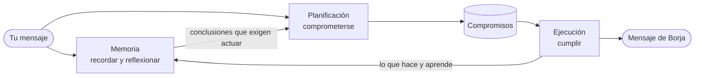

# Generative Agent

Se trata de un bot de Telegram para conversar con **Borja**, un asesor financiero. Borja recuerda lo que le cuentas, se forma una opinión sobre ti con el tiempo, sigue la actualidad financiera y cumple lo que acepta hacer. No hay comandos: se le escribe con naturalidad, y cada conversación tiene su propia memoria.

Está construido en Make.com sobre tres ideas, cada una tomada de un trabajo de investigación:

| Parte | Pregunta que resuelve | Se basa en |
| --- | --- | --- |
| [Memoria](#memoria) | ¿Qué sabe Borja y qué recuerda en cada momento? | Park *et al.* (2023), *Generative Agents* |
| [Planificación](#planificación) | ¿A qué se compromete y cuándo? | Shoham (1993), *Agent-oriented programming* |
| [Ejecución](#ejecución) | ¿Cómo cumple lo que ha prometido? | Shinn *et al.* (2023), *Reflexion* |

La memoria vive en Airtable, los compromisos en un almacén de datos de Make y el lenguaje lo pone Gemini.

> [!NOTE]
> La documentación técnica, con cada escenario, sus prompts y sus costes, está en [DOCUMENTACION.md](DOCUMENTACION.md).

## 1. Qué hace

| | Qué hace Borja |
| --- | --- |
| **Recuerda** | Guarda cada mensaje y, antes de responder, recupera lo que viene al caso. |
| **Reflexiona** | De vez en cuando saca conclusiones de lo vivido y las guarda como recuerdos nuevos. |
| **Se compromete** | Si le pides algo («avísame mañana de cómo abre Inditex») o le liberas de algo («olvida lo de Inditex»), decide con reglas fijas si acepta, y te lo dice. |
| **Cumple** | Cada media hora, en su horario, hace lo que tiene pendiente. Si no puede cumplir algo que te prometió, te avisa. |
| **Lee la prensa** | Dos veces al día guarda los titulares que afectan a tu cartera, con lo que implican. |
| **Lleva tu cartera, cotiza y calcula** | Apunta las posiciones que le cuentas, consulta precios en Yahoo Finance y resuelve las cuentas con código, no a ojo. |
| **Estudia** | Si le haces una pregunta profesional que exige consultar datos, investiga en la web y guarda lo aprendido. |

Las tres partes trabajan juntas: lo que dices entra en la memoria y en la planificación; la planificación deja compromisos; la ejecución los cumple, y lo que hace vuelve a la memoria.

## 2. Memoria

**Para qué sirve.** Para que Borja se comporte de forma coherente con lo que ha vivido: que no te pregunte dos veces lo mismo, que recuerde tu cartera y que su opinión sobre ti cambie con el tiempo.

**La idea.** Toda la experiencia del agente se guarda en un único registro, como un diario: cada entrada es un recuerdo escrito en lenguaje natural. Lo difícil no es guardar, sino elegir qué recordar en cada momento. Para eso cada recuerdo lleva tres medidas:

- **Recencia:** cuánto hace que se usó por última vez. Se desvanece con las horas.
- **Importancia:** de 1 (cepillarse los dientes) a 10 (una ruptura). La puntúa Gemini al guardar el recuerdo.
- **Relevancia:** cuánto se parece a lo que se está hablando. Se calcula con su *vector*, una representación numérica del significado que permite buscar por parecido.

**Cómo funciona.**

1. **Escribir.** Todo entra por un único escenario, (2) Escribir: tus mensajes, las respuestas de Borja, sus reflexiones y lo que aprende. Cada recuerdo se guarda en Airtable con su importancia y su vector. Lo que Borja te escribe lo manda (18) Enviar, que lo memoriza en el mismo paso.
2. **Recuperar.** Ante una pregunta, (4) Recuperar suma las tres medidas y devuelve los recuerdos con mejor puntuación. La cuenta la hace código, no el modelo.
3. **Reflexionar.** Cuando se acumula bastante importancia sin procesar, (3) Reflexionar se pregunta qué ha aprendido, busca los recuerdos que lo prueban y guarda cinco conclusiones que los citan. Las conclusiones son también recuerdos, así que pueden alimentar reflexiones posteriores.
4. **Resumir.** (7) Resumen del agente reconstruye quién es Borja a partir de su memoria.

**Referencia.** Park, J. S., O'Brien, J. C., Cai, C. J., Morris, M. R., Liang, P. y Bernstein, M. S. (2023). *Generative Agents: Interactive Simulacra of Human Behavior*. UIST '23. [arXiv:2304.03442](https://arxiv.org/abs/2304.03442). Apartados 4.1 (memoria y recuperación) y 4.2 (reflexión).

## 3. Planificación

**Para qué sirve.** Para que Borja decida qué va a hacer y cuándo, y para que solo prometa lo que sabe hacer.

**La idea.** Planificar es comprometerse. Un compromiso es la obligación de hacer algo en un momento dado, ante alguien o ante uno mismo; cuando es ante uno mismo, es una decisión. «Te aviso el lunes a las 10 de cómo abre Inditex» es un compromiso con un momento, un destinatario y un contenido. Borja no improvisa promesas: unas reglas fijas deciden si acepta cada una.

**De dónde salen los compromisos.**

| Fuente | Cómo |
| --- | --- |
| **Lo que pides** | Antes de contestarte, (6) Responder clasifica tu mensaje: petición, liberación o ninguna de las dos. Para hacerlo ve tus compromisos pendientes, cada uno con su clave, y señala de cuál te libera, cuál repites o qué veto choca con lo que pides. Después consulta a (14) Comprometer. |
| **Sus reflexiones** | Si una conclusión le exige actuar, (3) Reflexionar le pide a Comprometer que se comprometa consigo mismo. |
| **Rutinas** | Cada laborable, (10) Despertador le ordena preparar la agenda del día, y la agenda le ordena estudiar cada evento. |

**Las reglas.** Comprometer acepta un compromiso solo si se cumplen todas:

1. Borja sabe hacerlo y, si es un mensaje, sabe a quién enviarlo.
2. No repite un compromiso que ya tiene.
3. No contradice un veto.
4. No encadena demasiados compromisos.
5. Hay menos de **10 pendientes con ese usuario**, sin contar los vetos.

Un **veto** es un compromiso de no hacer algo, y puede ser de tres clases:

| Veto | Ejemplo | Qué impide |
| --- | --- | --- |
| De una acción | «No me escribas más» | Toda esa acción hacia ti |
| De un valor | «No me avises más de Inditex» | Esa acción, solo para ese valor |
| De un tema | «No me preguntes por mi cartera» | Lo que trate de ese tema |

Al aceptar un veto, Borja abandona lo que tuviera pendiente y choque con él.

Comprometer también ajusta el momento al horario de Borja (laborables de 8:00 a 20:30) y fija hasta cuándo vale el compromiso. Su respuesta es una de cuatro (aceptado, rechazado con el motivo, liberado o nada) y Borja contesta ateniéndose a ella: no promete lo que no se ha aceptado. Los compromisos se guardan con su estado y nunca se borran.

**Referencia.** Shoham, Y. (1993). *Agent-oriented programming*. Artificial Intelligence, 60(1), 51–92. [doi:10.1016/0004-3702(93)90034-9](https://doi.org/10.1016/0004-3702(93)90034-9). De ahí salen el estado mental del agente (creencias, capacidades y compromisos), las reglas de compromiso, los actos de pedir (REQUEST) y liberar (UNREQUEST), la abstención (REFRAIN) y el ciclo del intérprete AGENT-0.

## 4. Ejecución

**Para qué sirve.** Para que Borja cumpla lo que ha prometido y compruebe que lo ha logrado antes de darlo por hecho.

**La idea.** Borja trabaja por pasos, como lo haría una persona: hace algo, mira el resultado y corrige si hace falta. Así un compromiso puede pedir cualquier cosa que sus herramientas resuelvan, y ninguno se da por cumplido sin comprobarlo.

**Cómo funciona.** Cada media hora, en horario de trabajo, (11) Cumplir toma los compromisos vencidos. Antes de nada reserva cada uno, para no hacerlo dos veces. Las dos rutinas del agente, agendar el día y estudiar un evento, las resuelve él mismo. Todo lo demás se lo pasa a tres escenarios que se llaman en cadena:

| Escenario | Papel | Ejemplo con «Mañana a las 10 dime cómo abre Inditex» |
| --- | --- | --- |
| **(15) Actuar** | Elige un solo paso y lo da con una herramienta: cotizar, recordar, buscar, calcular, consultar la cartera, preguntar o enviar un mensaje | Primero cotiza Inditex; después te envía el mensaje |
| **(16) Observar** | Comprueba sin modelo que la herramienta respondió bien y luego, con Gemini, si ya se cumple el compromiso | Ve que hay precio y pide el paso siguiente; luego ve que el mensaje salió y lo cierra |
| **(17) Refinar** | Si algo falla, decide: corregir el paso, aplazarlo o darlo por fallido | Si Cotizar no reconoce el símbolo, ordena repetir con el correcto |

Cada compromiso admite como mucho 5 pasos y 2 correcciones. Los mensajes solo van al destinatario del compromiso y respetan sus vetos, y ningún paso puede crear compromisos nuevos ni decidir qué entra en la memoria. Si un compromiso falla tres veces, queda como fallido; si pasa su fecha de fin, como caducado. En los dos casos Borja te avisa si te lo había prometido.

> [!NOTE]
> Comprometer sigue aceptando solo las acciones de una lista cerrada (agendar, estudiar, informar, preguntar, investigar, cotizar y abstenerse). La ejecución por pasos ya admite cualquier encargo que sus herramientas resuelvan; abrir esa lista es el paso que falta para aprovecharlo.

**Referencia.** Shinn, N. *et al.* (2023). *Reflexion: Language Agents with Verbal Reinforcement Learning*. NeurIPS 2023. [arXiv:2303.11366](https://arxiv.org/abs/2303.11366). Su arquitectura tiene los mismos tres papeles:

| Reflexion | Human_proxy |
| --- | --- |
| Actor: da los pasos | (15) Actuar |
| Evaluador: juzga el resultado | (16) Observar |
| Autorreflexión: convierte el fallo en una instrucción para el intento siguiente | (17) Refinar |

## 5. Requisitos

- Una cuenta de Make.com con plan de pago, porque la calculadora usa Make Code. Con un usuario, el sistema gasta unos 3.400–3.900 créditos al mes antes de conversar (sección 21 de la documentación).
- Una base de Airtable, una clave de la API de Gemini y un bot de Telegram.
- Opcional: Slack, para registrar las conversaciones en un canal.

Las cotizaciones y la prensa no necesitan clave.

> [!WARNING]
> Si Make se queda sin créditos, todos los escenarios se paran hasta que se renuevan o se compran más. Lo que se escriba al bot mientras tanto queda en cola y se procesa después.

## 6. Instalación

1. Crea en Airtable la tabla Memory Stream con los campos de la sección 3.
2. Crea en Make tres almacenes de datos:
   - **Caché:** agente, chat_id, resumen, actualizado y token. Guarda en ella el registro `perfil|<agente>` con la descripción del personaje en `resumen` y el token secreto en `token`.
   - **Cartera:** agente, chat_id, cartera, posiciones y actualizado.
   - **Compromisos:** los quince campos de la sección 16, incluidos `estado` y `fin`.
3. Importa los blueprints. Crea primero todos los webhooks y después rellena las llamadas, porque hay dependencias circulares: Escribir llama a Reflexionar y Reflexionar a Escribir.
4. Elige un token secreto. Ponlo en lugar de `<TOKEN>` en el filtro «Token correcto» de cada escenario con webhook y en el campo `token` del registro `perfil|<agente>`. Es el mismo en todos, y no hay que escribirlo en ninguna llamada.
5. Sustituye el resto de marcadores (tabla siguiente). Las notas de cada webhook dicen qué módulos lo llaman.
6. Elige en cada módulo las conexiones y los almacenes de datos, que llegan vacíos.
7. Fija la programación, toda en hora de Madrid:

   | Escenario | Programación |
   | --- | --- |
   | Escenarios con webhook | Inmediata |
   | Despertador | Diaria, a las 5:00 |
   | Cumplir | Cada 30 minutos, laborables de 8:00 a 20:30 |
   | Noticias | Laborables, a las 8:00 y a las 16:00 |

| Marcador | Qué poner |
| --- | --- |
| `<TOKEN>` | El token secreto común |
| `<WEBHOOK_ESCRIBIR>`, `<WEBHOOK_RESPONDER>`… | El identificador del webhook de cada escenario |
| `<AIRTABLE_BASE_ID>`, `<AIRTABLE_TABLE_ID>` | La base y la tabla Memory Stream |
| `<FLD_MEMORIA>`, `<FLD_TIPO>`… | El ID de cada campo de la tabla; el nombre indica cuál |
| `<SLACK_CHANNEL_ID>` | El canal de Slack, si lo usas |
| `<USUARIO_TELEGRAM_ID>` | Tu ID numérico de Telegram, en los dos filtros del Gateway que separan al usuario identificado del resto |

## 7. Seguridad

> [!CAUTION]
> No publiques las URLs de los webhooks ni el token. Si se expone alguno, regenera el webhook o cambia el token en todos los escenarios a la vez.

- **Token.** Cada llamada entre escenarios lleva el token, y cada escenario con webhook lo comprueba antes de hacer nada. El Gateway, Cumplir y Noticias lo leen del perfil del agente; los demás reenvían el que reciben. Un webhook bloqueado por el token responde igualmente 200, así que el error no se ve desde fuera: se ve en el historial del escenario.
- **Datos.** Airtable guarda literalmente lo que cada usuario dice al bot; Cartera, sus inversiones; Compromisos, lo que el agente le ha prometido. Si el bot lo usan otras personas, deben saberlo.
- **Código.** La ruta de cálculo ejecuta el código que escribe el modelo, en el entorno aislado de Make y tras un filtro de patrones. Si el bot va a hablar con desconocidos, lee la sección 22 de la documentación.

## 8. Borja frente al estado del arte

Esta sección sitúa Human_proxy, área por área, frente a las técnicas recientes de la investigación sobre agentes. No es una hoja de ruta aprobada, sino un mapa de lo que separa al proyecto de esas técnicas y de lo que costaría acercarse a cada una.

| Área | Qué hace Borja | Qué propone la investigación | Distancia |
| --- | --- | --- | --- |
| [Personalidad](#personalidad) | Un resumen en prosa que se regenera a partir de la memoria | Un núcleo estable de atributos y la medición de la coherencia con jueces | Media: falta un núcleo fijo y no se mide la deriva |
| [Memoria](#memoria-1) | Registro único de recuerdos, reflexión por umbral y olvido por regla fija | Memoria jerárquica, olvido según el uso, habilidades reutilizables y grafos | Media: la base es la misma; faltan el olvido según el uso y la reutilización de lo que ha funcionado |
| [Planificación](#planificación-1) | Plan explícito antes de actuar, evaluación de cada paso y replanificación | Exploración de varias alternativas y planificadores formales | Baja en lo útil para este dominio |
| [Herramientas](#herramientas) | Escenarios de Make y módulos propios; el cálculo con código | Código como acción universal y protocolo MCP | Media: Make ya ofrece un servidor MCP |
| [Orquestación](#orquestación) | 20 escenarios de Make que se invocan entre sí como funciones | Marcos en código con ejecución duradera y varios agentes | Alta, y no siempre conviene recorrerla |
| [Evaluación](#evaluación) | Pruebas manuales | Baterías de evaluación automáticas | Alta |

### Personalidad

Borja no tiene una descripción fija del personaje. Como en Generative Agents, su identidad es un resumen que se reconstruye a partir de la memoria. El escenario Resumen del agente recupera los recuerdos sobre sus rasgos, su ocupación, su progreso y su interlocutor, y Gemini redacta cada uno de esos apartados en una o dos frases. El resultado se guarda en la Caché por agente y chat, y entra como instrucción de sistema en las llamadas en las que Gemini habla como Borja. Su carácter sale, por tanto, de la memoria y cambia con ella. Si no hay recuerdos sobre un apartado, ese apartado queda en «sin datos».

Sobre la coherencia de la personalidad hay tres líneas de trabajo, y ninguna dice exactamente lo que se le suele atribuir.

| Hallazgo | Alcance |
| --- | --- |
| **Deriva de la persona.** Un modelo deja de seguir la personalidad de su *system prompt* en unas ocho rondas de diálogo. Los autores lo atribuyen, como hipótesis, a que la atención al *system prompt* decae a medida que crece la conversación (Li *et al.*, 2024). | Afecta a conversaciones largas dentro de una misma llamada. Proponen dos remedios: *split-softmax*, que actúa sobre la atención del modelo y no se puede usar con Gemini desde Make, y la repetición del *system prompt*. |
| **Personas descriptivas y tabulares.** Cuanto más texto genera el LLM al crear perfiles sintéticos, más sesgada sale la población simulada (Li *et al.*, 2025). | El artículo trata de simular poblaciones para encuestas y elecciones, no de mantener el carácter de un agente. Los perfiles tabulares quedan entre los perfiles sin texto generado y los descriptivos, y el artículo no recomienda ninguno. |
| **Jueces de personalidad.** Otro modelo infiere los rasgos de los cinco grandes factores (Big Five u OCEAN) a partir de lo que dice el agente, con entrevistas psicológicas (InCharacter) o con debates entre agentes (*Can LLM Agents Maintain a Persona in Discourse?*). | Son métodos de evaluación posterior, no controles en tiempo real. Su fiabilidad varía por rasgo: en la extraversión, por ejemplo, los jueces coinciden poco. |

Lo que tendría sentido aquí es separar lo que Borja es de lo que Borja sabe. Una ficha breve y estructurada, que no se regenerara nunca, recogería su papel, su tono, sus límites y sus niveles OCEAN, y entraría junto al resumen dinámico en cada llamada en la que Gemini habla como Borja. Así la memoria podría cambiar lo que sabe y opina, pero no quién es. Para comprobar que lo consigue bastaría un juez diario. Despertador llamaría a un escenario que puntuara los mensajes de Borja del día frente a los rasgos de la ficha y que, si encontrara una desviación, escribiera una observación que Reflexionar pudiera usar. Hacerlo en tiempo real duplicaría las llamadas a Gemini por mensaje, y la fiabilidad actual de estos jueces no lo justifica.

### Memoria

Todos los recuerdos de Borja están en un único registro en Airtable, el *memory stream* de Generative Agents. Cada recuerdo se puntúa por recencia, importancia y relevancia, y la importancia mide su peso económico, no su intensidad emocional. Cuando la importancia acumulada de las observaciones sin reflejar llega a 30, Reflexionar extrae conclusiones y las guarda como recuerdos nuevos. Olvidar, por su parte, borra cada día los recuerdos de importancia menor que 4 que tienen más de 15 días.

La investigación ha propuesto otras formas de organizar la memoria de un agente, con un encaje muy desigual en este proyecto.

| Técnica | Qué hace | Encaje en Human_proxy |
| --- | --- | --- |
| **Memoria jerárquica** (MemGPT) | Trata el contexto del modelo como memoria de trabajo y el almacenamiento como disco. El propio agente decide, con llamadas a funciones, qué sube al contexto y qué guarda. | Bajo. Recuperar ya decide qué entra en cada llamada, con una fórmula fija en código. Ceder esa decisión al modelo añadiría llamadas y quitaría control. |
| **Olvido según el uso** (MemoryBank) | Aplica la curva de olvido de Ebbinghaus: un recuerdo se debilita con el tiempo y se refuerza cada vez que se recupera. | Alto. Olvidar usa una regla fija de importancia y antigüedad. Como cada recuerdo ya registra cuándo se usó por última vez, que es lo que mide la recencia, se podría olvidar lo que no se usa, en vez de lo que es antiguo. |
| **Biblioteca de habilidades** (Voyager) | Guarda como programas reutilizables las soluciones que han funcionado. | Medio. Los planes de Actuar ya son JSON con criterio y acciones. Guardar los que Observar da por cumplidos permitiría reutilizarlos en encargos parecidos. Hoy el plan se borra con el compromiso. |
| **Grafos de conocimiento** (Zep) | Guarda entidades y relaciones con su vigencia en el tiempo. | Medio. Encajaría con la cartera y los valores que sigue el usuario, que son datos relacionados que cambian. Supone otra base de datos y otro proceso de extracción. |

### Planificación

Borja planifica en dos niveles. Primero decide si se compromete, y unas reglas fijas, tomadas de Shoham (1993), establecen si acepta cada encargo y para cuándo. Después, cuando llega el momento de cumplirlo, Actuar escribe un plan antes de dar ningún paso, con un criterio de cumplimiento comprobable y hasta 5 acciones, cada una con su objetivo y su expectativa. Observar compara cada resultado con lo esperado y, si algo falla, Refinar puede sustituir las acciones pendientes, como mucho dos veces, aplazar el compromiso o darlo por fallido. Es una descomposición previa del problema con replanificación, en la línea de Plan-and-Solve (Wang *et al.*, 2023), y no una sucesión de pasos improvisados.

Las técnicas que van más allá exploran varias soluciones a la vez o delegan el plan en un planificador formal. Ninguna de las dos encaja bien con encargos tan cortos como los de Borja.

| Técnica | Qué hace | Encaje en Human_proxy |
| --- | --- | --- |
| **Árboles de pensamiento** (Tree of Thoughts) | Explora varias alternativas a la vez y retrocede si un camino no lleva a ninguna parte. | Bajo para los encargos actuales, que son cortos (cotizar y avisar, consultar y calcular). Multiplicaría las llamadas a Gemini, y con ellas los créditos, por el número de ramas. |
| **Planificadores formales** (LLM+P) | Traduce el problema a PDDL y lo resuelve un planificador clásico, que garantiza que el plan es factible. | Muy bajo. Sirve para problemas con estados y acciones bien definidos, no para conversar sobre finanzas. |

### Herramientas

Borja tiene siete herramientas. Cuatro son escenarios de Make que Actuar invoca por webhook, con la autenticación por clave API de Make: cotizar (Cotizar), recordar (Recuperar), preguntar (Interpelar) y enviar. Las otras tres son módulos del propio Actuar: la búsqueda se hace con Gemini, el cálculo con un módulo de código y la consulta de la cartera, en el almacén. El cálculo ejecuta ya código escrito por el modelo, en el entorno aislado de Make, que es justo lo que la investigación propone generalizar.

| Técnica | Qué hace | Encaje en Human_proxy |
| --- | --- | --- |
| **Código como acción** (CodeAct) | El agente actúa escribiendo código ejecutable en vez de llamadas JSON, y puede combinar varias herramientas en un solo paso. | Parcial. Borja ya lo hace para calcular. Extenderlo a todo exigiría un entorno de ejecución con acceso a las herramientas, que Make no da dentro de un módulo de código. |
| **Model Context Protocol** (MCP) | Protocolo abierto para exponer herramientas y datos a cualquier cliente de IA. | Alto. Make tiene un servidor MCP que expone como herramientas los escenarios con programación bajo demanda y entradas y salidas definidas. Las habilidades de Borja se podrían usar desde otros clientes sin reescribirlas. Hoy se disparan por webhook y habría que adaptarlas. |

### Orquestación

Human_proxy está hecho con 20 escenarios de Make. Cada uno tiene una entrada y una salida definidas, y los demás lo invocan por webhook, como a una función. El diseño es modular, aunque no del todo independiente: Escribir y Reflexionar, por ejemplo, se invocan mutuamente. Un fallo a mitad de camino tampoco hace perder un compromiso, porque Cumplir lo vuelve a lanzar media hora después, y así hasta tres veces.

La investigación reciente va en otra dirección. Marcos de trabajo como LangGraph sustituyen la orquestación visual por código y guardan el estado de cada ejecución, de modo que pueden reanudarla donde se cortó. Otros, como MetaGPT, reparten el trabajo entre varios agentes especializados que se comunican a través de un espacio de mensajes compartido.

Pasar a un marco en código acabaría con el gasto en créditos de Make y con la fragilidad de encadenar escenarios por webhook. A cambio habría que pagar y mantener un alojamiento, y se perderían la cola de los webhooks, el historial de ejecuciones y el editor visual, que hoy son la principal herramienta para depurar el sistema. Repartir a Borja entre varios agentes, como un analista, un auditor de riesgos y un comunicador, tendría sentido con encargos largos y complejos. Con los actuales, que se resuelven en uno o en pocos pasos, solo añadiría coordinación.

### Evaluación

Hoy las pruebas son manuales. Se conversa con Borja por Telegram y se revisa en el historial de Make qué ha hecho cada escenario.

En la investigación se usan baterías de pruebas automáticas. AgentBench mide cómo se desempeñan los modelos cuando actúan como agentes en varios entornos. PersonaMem mide otra cosa: si un modelo sigue la evolución del perfil y las preferencias de su usuario a lo largo del tiempo. No evalúa la personalidad del agente, pero sí lo que intenta capturar el apartado «interlocutor» del resumen de Borja.

Para Human_proxy bastaría un conjunto fijo de conversaciones de prueba, cada una con lo que se espera que ocurra: si Borja acepta o no el compromiso, qué acciones ejecuta y qué recuerdos guarda. Lanzarlas después de cada cambio sustituiría las pruebas sueltas por una comprobación repetible.
