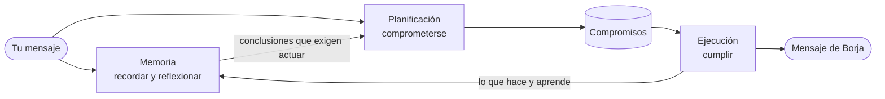

# Human_proxy

Human_proxy es un bot de Telegram para conversar con **Borja**, un asesor financiero ficticio del Madrid de los 90. Recuerda lo que le cuentas, se forma una opinión sobre ti y sobre sí mismo, sigue la actualidad financiera y cumple lo que acepta hacer. No hay comandos: se le escribe con naturalidad, y cada conversación tiene su propia memoria.

Por debajo, implementa en Make.com la memoria, la recuperación y la reflexión de *Generative Agents* (Park et al., 2023, [arXiv 2304.03442](https://arxiv.org/abs/2304.03442)). Su iniciativa sigue la programación orientada a agentes de Shoham (*Agent-oriented programming*, Artificial Intelligence 60, 1993): el agente tiene compromisos, cada uno con su momento, y los cumple cuando vencen. La memoria vive en Airtable y el lenguaje lo pone Gemini.

> [!NOTE]
> La documentación técnica, con cada escenario, sus prompts y sus costes, está en [DOCUMENTACION.md](DOCUMENTACION.md).

## Qué hace

| | Qué hace Borja |
| --- | --- |
| **Recuerda** | Guarda cada mensaje con su importancia y su vector. Antes de responder, recupera lo más relevante combinando recencia, importancia y similitud. |
| **Reflexiona** | Cuando la importancia acumulada supera un umbral, extrae conclusiones y las guarda como recuerdos. Si una le exige actuar, se compromete consigo mismo. |
| **Se compromete** | Si le pides algo («avísame mañana de cómo abre Inditex») o le liberas de algo («olvida lo de Inditex»), unas reglas fijas deciden si acepta, rechaza o libera, y te lo dice. Si le pides que no haga algo, anula lo que tuviera pendiente de eso. |
| **Cumple** | Cada media hora, en su horario, ejecuta los compromisos vencidos. Nada se borra: cada compromiso termina cumplido, fallido, liberado o caducado, y si no puede cumplir algo que te prometió, te avisa. |
| **Lee la prensa** | Dos veces al día guarda los titulares que afectan a tu cartera, con su implicación. |
| **Lleva tu cartera, cotiza y calcula** | Apunta las posiciones que le cuentas, consulta precios en Yahoo Finance y resuelve las cuentas con código, no con el modelo. |
| **Estudia** | Ante una pregunta profesional que no sabe responder, investiga en la web y guarda lo aprendido. |

## Memoria

**Objetivo.** Que el agente recuerde lo que vive y se comporte de forma coherente con ello a lo largo del tiempo, como en *Generative Agents*.

**Funcionamiento.**

1. **Escribir.** Todo entra en la memoria por un único escenario, (2) Escribir: los mensajes del usuario, las respuestas del agente, sus reflexiones y lo que aprende. Cada recuerdo se guarda en Airtable con su importancia, de 1 a 10, puntuada por Gemini, y con su vector. Pertenece a un agente y a una conversación.
2. **Recuperar.** (4) Recuperar devuelve, para una consulta, los recuerdos con mejor puntuación combinada de recencia, importancia y relevancia. La calcula código, no el modelo.
3. **Reflexionar.** Cuando la importancia acumulada de las observaciones sin reflejar supera 150, (3) Reflexionar formula preguntas sobre los recuerdos recientes, recupera las evidencias y guarda cinco conclusiones que citan los recuerdos en que se apoyan. Las conclusiones son también recuerdos: se recuperan y alimentan reflexiones posteriores.
4. **Resumir.** (7) Resumen del agente reconstruye quién es el agente a partir de su memoria.

## Planificación

**Objetivo.** Decidir qué hará el agente y cuándo, comprometiéndose solo a lo que sabe hacer. Sigue el modelo de compromisos de Shoham; el plan diario de *Generative Agents* se abandonó.

**Funcionamiento.** Planificar es comprometerse. Un compromiso es la obligación de hacer algo en un momento dado, ante un usuario o ante sí mismo; en el segundo caso es una decisión. Los compromisos nacen de tres fuentes:

| Fuente | Cómo |
| --- | --- |
| **Lo que pide el usuario** | Antes de contestar, (6) Responder clasifica el mensaje como petición (REQUEST), liberación (UNREQUEST) o ninguna de las dos. Ve los compromisos pendientes con ese usuario, cada uno con su clave, y señala de cuáles le libera, cuál repite o qué veto choca con la petición. Después consulta a (14) Comprometer. |
| **Las reflexiones** | Si una conclusión exige actuar, (3) Reflexionar envía una decisión a Comprometer. |
| **Reglas fijas** | (10) Despertador ordena cada laborable preparar la agenda, y la agenda ordena estudiar cada evento. |

Comprometer decide con reglas deterministas. Acepta un compromiso solo si:

- el agente sabe hacerlo y, si es un mensaje, tiene destinatario;
- no repite otro compromiso ni contradice un veto;
- no alarga demasiado la cadena de compromisos;
- hay menos de **10 pendientes con ese usuario**, sin contar los vetos.

Un veto puede ser de una acción entera («no me escribas más»), de un valor («no me avises más de Inditex») o de un tema («no me preguntes por mi cartera»). Al aceptarlo, Comprometer libera lo pendiente que choca con él.

Comprometer ajusta además el momento al horario de trabajo (laborables de 8:00 a 20:30) y fija hasta cuándo vale el compromiso. Responde aceptado, rechazado con el motivo, liberado o nada, y Borja contesta ateniéndose a esa respuesta: no promete lo que no se ha aceptado. Los compromisos se guardan en el almacén Compromisos con su estado y nunca se borran.

## Ejecución (en desarrollo)

> [!IMPORTANT]
> **En desarrollo.** (15) Actuar, (16) Observar y (17) Refinar están creados en Make y **desactivados**. Mientras tanto, (11) Cumplir ejecuta los compromisos con acciones fijas.

**Objetivo.** Llevar a cabo los compromisos y comprobar que se han logrado antes de darlos por cumplidos, de modo que un compromiso pueda pedir cualquier cosa que el agente sepa resolver con sus herramientas.

**Hoy.** Cada media hora, en horario de trabajo, (11) Cumplir ejecuta los compromisos vencidos con seis acciones fijas: agendar, estudiar, informar, preguntar, investigar y cotizar. Reserva cada compromiso antes de actuar y lo marca como cumplido al terminar. Tras tres fallos lo marca como fallido y, pasada su fecha de fin, como caducado; en ambos casos avisa al usuario si se lo había prometido.

**Funcionamiento previsto.** Sigue el patrón **actuar, observar y refinar**. Cumplir queda como reloj y pasa cada compromiso vencido a Actuar; agendar y estudiar, que son rutinas, conservan sus rutas.

| Escenario | Papel |
| --- | --- |
| **(15) Actuar** | Elige un solo paso a partir del compromiso, de su criterio de cumplimiento y de lo hecho hasta entonces. Lo ejecuta con una herramienta: cotizar, recordar, buscar, calcular, consultar la cartera, preguntar o enviar un mensaje. |
| **(16) Observar** | Comprueba sin modelo que la herramienta devolvió lo que debía y después, con Gemini, si se cumple el criterio. Cierra el compromiso, vuelve a Actuar, lo aplaza si su condición aún no se da, o pasa a Refinar si algo ha fallado. |
| **(17) Refinar** | Corrige el paso, aplaza el compromiso o lo da por fallido. |

Cada ejecución admite como mucho 5 pasos y 2 correcciones. Los mensajes van solo al destinatario del compromiso y respetan sus vetos, y ningún paso crea compromisos ni decide qué se guarda en la memoria. Con este cambio, cada compromiso llevará su criterio de cumplimiento y su contenido será libre: Comprometer rechazará lo que no pueda resolverse con esas herramientas.

**Pendiente antes de activarlos:**

- [ ] Que Interpelar responda con lo que envía.
- [ ] Que Cumplir pase los compromisos a Actuar.
- [ ] Que el almacén Compromisos tenga el campo del criterio.

El detalle está en la sección 18 de la documentación.

## Escenarios

| Archivo | Escenario | Disparo |
| --- | --- | --- |
| `blueprints/01_gateway_telegram.blueprint.json` | (1) Gateway | Mensaje en Telegram |
| `blueprints/02_memoria_escribir.blueprint.json` | (2) Escribir | Webhook |
| `blueprints/03_memoria_reflexionar.blueprint.json` | (3) Reflexionar | Webhook |
| `blueprints/04_memoria_recuperar.blueprint.json` | (4) Recuperar | Webhook |
| `blueprints/05_planificar.blueprint.json` | (5) Planificar · obsoleto | Desactivado |
| `blueprints/06_responder.blueprint.json` | (6) Responder | Webhook |
| `blueprints/07_resumen_agente.blueprint.json` | (7) Resumen del agente | Webhook |
| `blueprints/08_estudiar.blueprint.json` | (8) Estudiar | Webhook |
| `blueprints/09_interpelar.blueprint.json` | (9) Interpelar | Webhook |
| `blueprints/10_despertador.blueprint.json` | (10) Despertador | Diario, 5:00 |
| `blueprints/11_cumplir.blueprint.json` | (11) Cumplir | Cada 30 minutos, laborables de 8:00 a 20:30 |
| `blueprints/12_noticias.blueprint.json` | (12) Noticias | Laborables, 8:00 y 16:00 |
| `blueprints/13_cotizar.blueprint.json` | (13) Cotizar | Webhook |
| `blueprints/14_comprometer.blueprint.json` | (14) Comprometer | Webhook |

Planificar y la versión anterior de Percibir siguen en Make, desactivados, con el prefijo «[OBSOLETO]». No hacen falta. Cumplir se llamaba Percibir hasta noviembre de 2026.

Cada blueprint lleva notas de Make en sus webhooks y en sus llamadas, con el origen y el destino.

## Requisitos

- Una cuenta de Make.com con plan de pago, porque la calculadora usa Make Code. Con un usuario, el sistema gasta unos 3.400–3.900 créditos al mes antes de conversar (sección 21 de la documentación).
- Una base de Airtable, una clave de la API de Gemini y un bot de Telegram.
- Opcional: Slack, para registrar las conversaciones en un canal.

Las cotizaciones y la prensa no necesitan clave.

> [!WARNING]
> Si Make se queda sin créditos, todos los escenarios se paran hasta que se renuevan o se compran más. Lo que se escriba al bot mientras tanto queda en cola y se procesa después.

## Instalación

1. Crea en Airtable la tabla Memory Stream con los campos de la sección 3.
2. Crea en Make tres almacenes de datos:
   - **Caché:** agente, chat_id, resumen y actualizado. Guarda en ella el registro `perfil|<agente>` con la descripción del personaje.
   - **Cartera:** agente, chat_id, cartera, posiciones y actualizado.
   - **Compromisos:** los quince campos de la sección 17, incluidos `estado` y `fin`.
3. Importa los blueprints. Crea primero todos los webhooks y después rellena las llamadas: hay dependencias circulares (Escribir llama a Reflexionar y Reflexionar a Escribir).
4. Elige un token secreto y ponlo en lugar de `<TOKEN>`, en los filtros «Token correcto» y en los cuerpos de las llamadas. Es el mismo en todos.
5. Sustituye el resto de marcadores (tabla siguiente). Las notas de cada webhook dicen qué módulos lo llaman.
6. Elige en cada módulo las conexiones y los almacenes de datos, que llegan vacíos.
7. Fija la programación, toda en hora de Madrid:

   | Escenario | Programación |
   | --- | --- |
   | Escenarios con webhook | Inmediata |
   | Despertador | Diaria, a las 5:00 |
   | Cumplir | Cada 30 minutos, laborables de 8:00 a 20:30 |
   | Noticias | Laborables, a las 8:00 y a las 16:00 |

| Marcador | Qué poner |
| --- | --- |
| `<TOKEN>` | El token secreto común |
| `<WEBHOOK_ESCRIBIR>`, `<WEBHOOK_RESPONDER>`… | El identificador del webhook de cada escenario |
| `<AIRTABLE_BASE_ID>`, `<AIRTABLE_TABLE_ID>`, `<AIRTABLE_VIEW_ID>` | La base, la tabla Memory Stream y su vista |
| `<FLD_MEMORIA>`, `<FLD_TIPO>`… | El ID de cada campo de la tabla; el nombre indica cuál |
| `<SLACK_CHANNEL_ID>` | El canal de Slack, si lo usas |
| `<USUARIO>` | Tu nombre, donde aparezca en un prompt o en un filtro |

## Seguridad

> [!CAUTION]
> No publiques las URLs de los webhooks ni el token. Si se expone alguno, regenera el webhook o cambia el token en todos los escenarios a la vez.

- **Token.** Cada llamada entre escenarios lleva el token, y cada escenario con webhook lo comprueba antes de hacer nada. Un webhook bloqueado por el token responde igualmente 200, así que el error no se ve desde fuera: se ve en el historial del escenario.
- **Datos.** Airtable guarda literalmente lo que cada usuario dice al bot; Cartera, sus inversiones; Compromisos, lo que el agente le ha prometido. Si el bot lo usan otras personas, deben saberlo.
- **Código.** La ruta de cálculo ejecuta el código que escribe el modelo, en el entorno aislado de Make y tras un filtro de patrones. Si el bot va a hablar con desconocidos, lee la sección 22 de la documentación.
